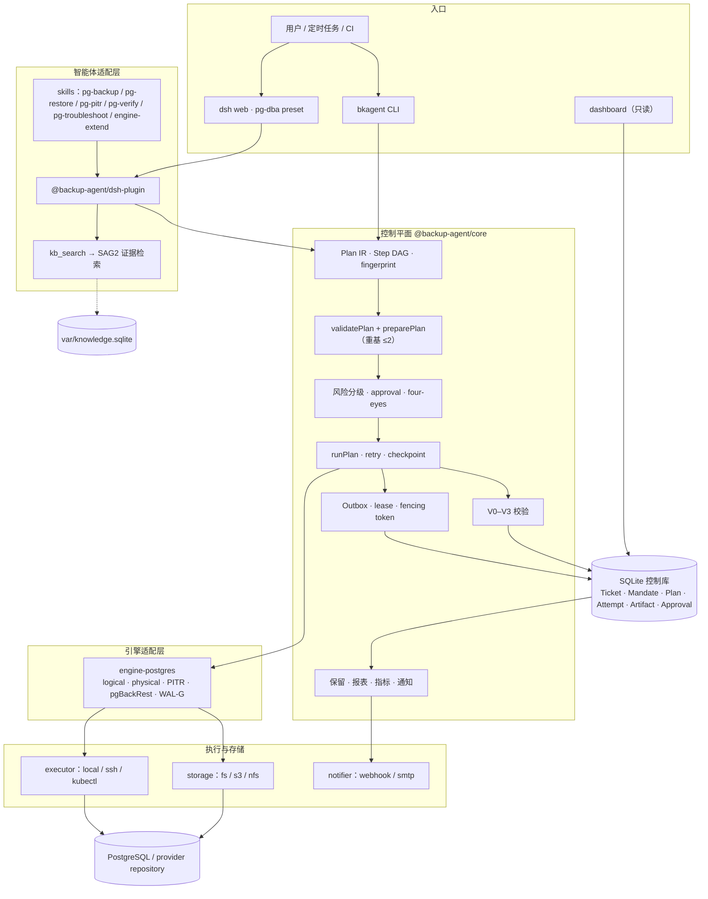
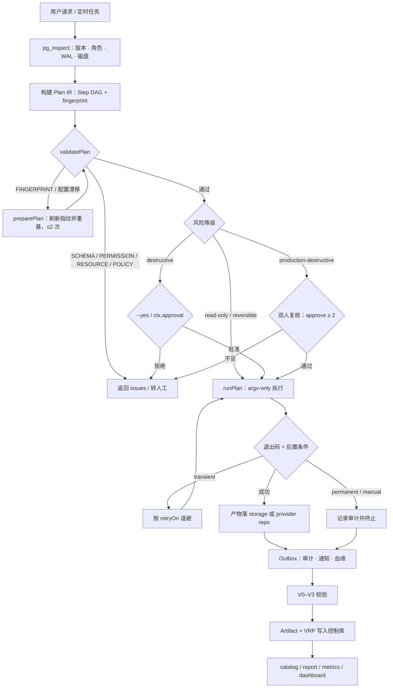
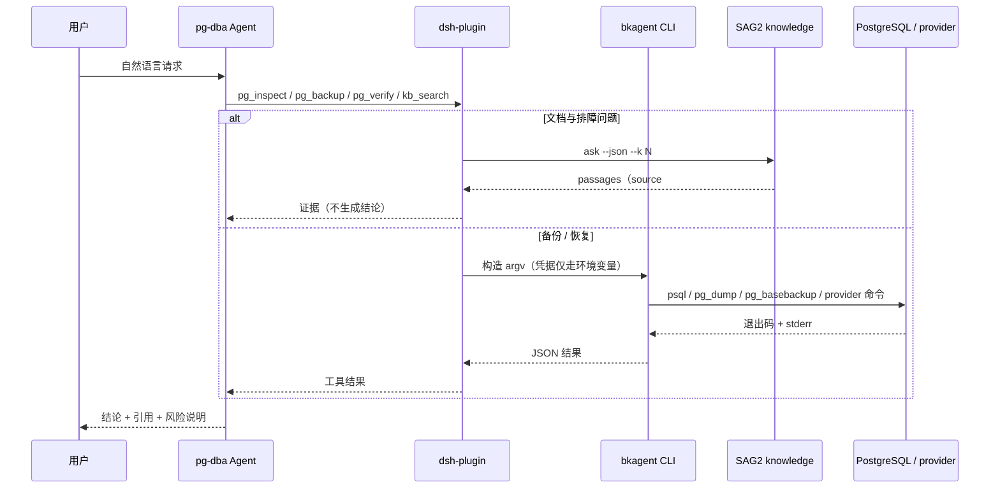

# 架构与流程

本文件与 `docs/plan-v1.1.md` §3 同步；方案为事实源，本文件用于 Git 跟踪与快速导航。

## 1. 分层架构

## 2. Plan/Apply 流程

## 3. dsh 调用时序

分层解耦：智能体层为轻量适配层（anti-corruption layer），仅承担协议转换与交互职责；业务语义与安全策略集中于核心库，确保交互式与无人值守两种场景行为一致。
