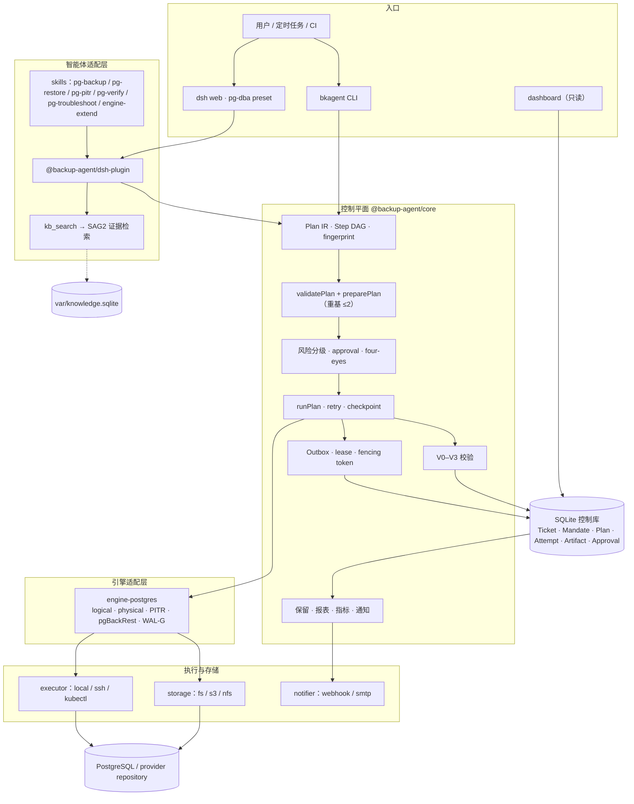
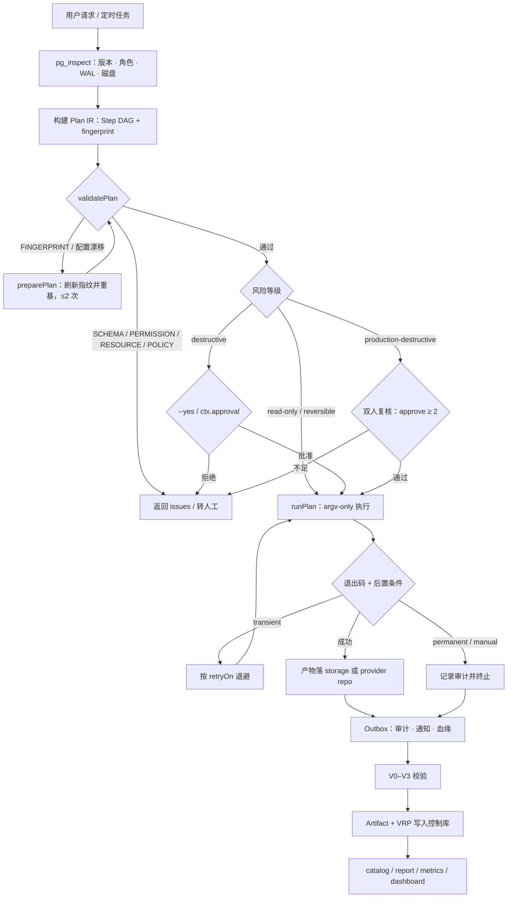
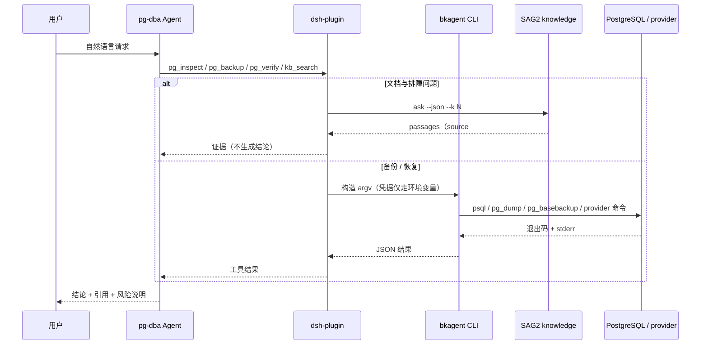

# 架构与流程

本文件与 `docs/plan-v1.1.md` §3 同步；方案为事实源，本文件用于 Git 跟踪与快速导航。

## 1. 分层架构

## 2. Plan/Apply 流程

### 2.1 CLI 破坏性授权门禁

`packages/cli/src/destructive-gate.ts` 是所有破坏性 CLI Plan 的集中门禁；所有逻辑 `restore`（输入可含任意 SQL）、`pitr`、`pgbackrest-restore`、`pgbackrest-expire`、`walg-restore`、`walg-prune` 在调用 `executePlan` 前都必须经过它。门禁失败关闭，依次要求：

1. `--yes` 显式确认；
2. 探测到的 `systemIdentifier` 非空，且与 Plan fingerprint 完全一致——无法证明目标身份时拒绝执行，不做回退；
3. 控制库（`--db` → `BKAGENT_DB` → `.bkagent/control.db`）中存在与 `plan.targetId` 精确匹配的 Asset，否则报出 targetId 与 `asset-set` 注册命令；
4. 命中生产环境 Asset 时升级为 `production-destructive`，要求两名不同审批人的当前审批（`protected` 只影响保留策略，不构成审批豁免）；审批绑定 `plan.fingerprint.configDigest`，按审批人取最新决定（后续 reject 覆盖先前 approve），执行主体自身的审批被排除。

执行前会再次探测并用最终 Plan 重新跑一遍门禁：逻辑恢复在 `preparePlan` 刷新时不再回填旧 `systemIdentifier`，无法证明身份即中止；PITR、pgBackRest、WAL-G 路径在执行器调用前重新探测，身份变化或不可得则不执行任何步骤。Asset 与审批决定还会在 `BEGIN IMMEDIATE` 的 run-start 事务中复核；门禁之后出现的 reject 或生产环境变更会回滚 lease/fence 与 run envelope，保证没有 argv 到达 executor。

审批记录自 migration `007_approval_history.sql` 起为 append-only；`four-eyes` 的身份来自 CLI 推导的 principal（`os:$USER` 或 `--principal`），仅用于防止误自审，不构成密码学身份证明。

### 2.2 CLI 单目标执行租约与 fencing

所有 `executePlan` 路径（`packages/cli/src/execute-plan.ts`）在执行前都要在控制库中取得 `plan.targetId` 的租约；未传 `--db` 时同样使用默认控制库（`BKAGENT_DB` → `.bkagent/control.db`），因此 `pgbackrest-backup`、`walg-backup` 也补齐了 `--db` 参数。

- **锁键就是 provider 特定的 `plan.targetId`**。同一 PostgreSQL 集群经由不同 provider 或不同 data directory 生成的 Plan 具有不同 `targetId`，彼此**不会**串行化；这里不是集群级互斥。
- 获取租约在 `Repository.transaction()`（SQLite `BEGIN IMMEDIATE`）内完成，跨进程的“读 fence → 递增 → 写入”因此是原子的。同一 owner 在租约未过期时也不能直接重新获取，只能 `renew`，否则会绕过 fence 递增。
- owner 每次调用都是 `<principal|cli>:<pid>:<random>`，不使用常量 `cli`，避免两次运行互相续租或释放。
- TTL 默认 60s，心跳间隔为 `TTL/3`；续租失败（token 不匹配、租约已过期、DB 异常）即中止 `AbortSignal`，runner 不再派发任何步骤并返回 `lease-lost`。租约过期后不会被 `renew` 复活。
- `finally` 中只释放 owner+token 匹配的那一行；心跳任务先结束再释放。子进程执行期间不持有任何长事务，控制库连接只用于心跳与终态写入。

**运行生命周期**（`packages/core/src/persistence/run-lifecycle.ts`，由 `executePlan` 统一调用，不在各命令里分别接线）：

- **start 先于副作用**：取得租约的同一个 `BEGIN IMMEDIATE` 事务内写入 Ticket（`in_progress`）、Mandate、Plan（`dispatched`）与 Attempt（`running`），使用 Plan 自带的 `ticketId`/`mandateId`（不再新建 ticket id），Attempt 记录真实 `targetId`、owner 与 lease token，并追加 ticket→plan、plan→attempt 血缘与确定性的 `audit.run` start 事件。事务提交后才允许派发子进程；start 写不进去就不会派发任何子进程，租约已过期也不会开始运行。
- **终态与 Outbox 同事务**：普通成功/失败在一个短事务内重新校验 `currentFence` 与仍然存活的租约行（owner/token/`expiresAt > now`），更新 Attempt 终态与错误字段、Ticket 状态、按需插入 Artifact、追加 attempt→artifact 血缘，并追加确定性的 `audit.run` 事件；失败时再加一条 `notify.failure` 事件。事务不跨越任何外部工作。终态写不进去时命令以 `lease-lost` 非成功退出，绝不把未留痕的运行报告为成功。
- `lease-lost`、fence 被取代或租约已过期时**不写任何终态、不写 Outbox**，Attempt 保持 `running` 交给对账；对账只有在匹配的活租约不存在/已过期/被更高 token 取代时才将其标为 `stalled`，即使运行时间已超过最初租约 TTL。
- 未传 `--db` 时同样写解析后的控制库（`BKAGENT_DB` → `.bkagent/control.db`），所有 `executePlan` 路径一致；provider 管理的备份不伪造本地 artifact 路径。

**fencing 边界**：fence 保护的是控制库提交。被取代或已过期的 worker 整个终态事务回滚，即使过期租约尚未被新 owner 接管也不能写入；外部 PostgreSQL、`pgbackrest`、`wal-g` 进程只在租约丢失时通过 `AbortSignal` **尽力**终止，provider 侧没有 fencing，不能据此断言外部副作用已被阻断。

### 2.3 Outbox 派发

`packages/core/src/persistence/outbox-dispatch.ts` + `bkagent outbox-dispatch --db … [--limit N] [--max-attempts N]` 是独立于执行的派发器（cron 示例见 `deploy/cron.example`），`executePlan` 内联派发是被禁止的。

- 认领（claim）在 `BEGIN IMMEDIATE` 内完成并递增每条记录的 `delivery_token`（migration `009_outbox_delivery.sql`），因此跨进程不会重复认领。
- 投递是**至少一次**，不承诺 exactly-once；`outbox_id` 与 idempotency key 在投递时附加到信封上供接收端去重，存储的 payload 保持不变以便审计/重放。
- 处理 `audit.run`（保留，不外发）与 `notify.failure`（webhook 地址只来自 `BKAGENT_WEBHOOK_URL`，不进入 argv、payload、日志）。未知 topic 直接 dead-letter。
- 处理器失败按有界指数退避重试，达到 `max-attempts` 后状态置为 `failed`；确认/重试时间在处理器返回之后采样，因此超出认领租约的投递不会被误确认，重试计划也以真实失败时间为起点。确认时必须匹配当前 `delivery_token` 与未过期认领租约，被回收的旧消费者不能覆盖新认领。`watchdog` 报告 pending/expired/dead-letter 计数；对账把 Attempt 标为 `stalled` 时在同一事务追加 `audit.run` 与 `notify.failure`，崩溃运行因此仍有持久审计记录。

## 3. dsh 调用时序

分层解耦：智能体层为轻量适配层（anti-corruption layer），仅承担协议转换与交互职责；业务语义与安全策略集中于核心库，确保交互式与无人值守两种场景行为一致。
