# bkagent 使用教程

本文以一个可复现的演示库为对象，按顺序执行 bkagent 的最小闭环：探测实例、登记资产、产出备份、校验恢复点、通过门禁恢复、查看台账与告警。每一步都给出实际执行的命令与真实输出，并说明这一步为什么必须存在。

适合两类读者：首次接触本项目、需要在本机完成端到端验证的 DBA；以及评估该链路是否满足生产要求的评审者。命令参数、门禁细则与全部 34 条命令的参考手册见 [usage.md](usage.md)，设计原理见 [architecture.md](architecture.md)；本教程只覆盖主线与常见分支。

源码仓库：[RoyDD/backup-agent](https://github.com/RoyDD/backup-agent)。本教程的 Markdown 源文件为 [`docs/tutorial.md`](https://github.com/RoyDD/backup-agent/blob/main/docs/tutorial.md)，单页版为 [`docs/tutorial.html`](https://github.com/RoyDD/backup-agent/blob/main/docs/tutorial.html)；文中提到的命令、脚本与插件均可在该仓库对应路径下查阅。

本教程的输出取自本地演练环境（PostgreSQL 16.15、控制库为临时目录下的 SQLite 文件），其中的 id、时间戳、大小与临时库名随环境变化，字段名与命令不变。截图里的产物路径位于演练临时目录，正文命令统一用 `/var/backups` 表示常规落地位置。

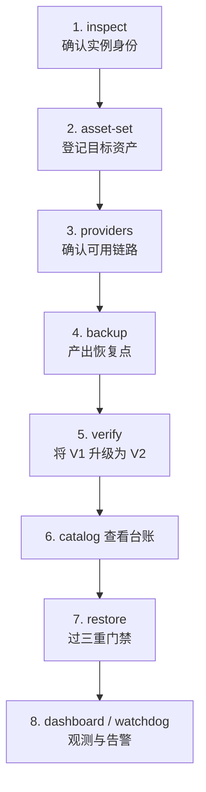

## 1. 准备环境

### 1.1 安装与构建

```sh
pnpm install
pnpm build:cli                       # 产出 dist/bkagent.mjs 与 dist/migrations
```

开发态可改用 `pnpm bkagent <command>`，由 `tsx` 直接从源码执行，参数与构建产物完全一致。后文命令统一写作 `bkagent`，指二者之一。

环境要求：Node.js ≥ 22.5（依赖 `node:sqlite`，运行时的 `ExperimentalWarning: SQLite` 属预期）、pnpm 11.24、目标 PostgreSQL 14–17 且 `psql` / `pg_dump` 可用。

### 1.2 准备一个可以备份的库

本文假定目标实例已有业务库；若不存在，可执行下列脚本创建 `bk_tut`（三张表、一个索引、200 条客户记录、800 条订单记录）。

```sh
createdb -h 127.0.0.1 -p 5432 -U postgres bk_tut
```

（下面命令按 5432 举例；本文截图取自 55416 的本地演练实例，端口按自己的实例替换。）

```sql
CREATE TABLE customers (
  id bigserial PRIMARY KEY, email text NOT NULL UNIQUE,
  region text NOT NULL, created_at timestamptz NOT NULL DEFAULT now()
);
CREATE TABLE orders (
  id bigserial PRIMARY KEY,
  customer_id bigint NOT NULL REFERENCES customers(id),
  status text NOT NULL, total_cents bigint NOT NULL CHECK (total_cents >= 0),
  created_at timestamptz NOT NULL DEFAULT now()
);
CREATE INDEX orders_customer_idx ON orders (customer_id, created_at DESC);
CREATE TABLE order_items (
  order_id bigint NOT NULL REFERENCES orders(id) ON DELETE CASCADE,
  sku text NOT NULL, qty int NOT NULL CHECK (qty > 0), price_cents bigint NOT NULL,
  PRIMARY KEY (order_id, sku)
);
INSERT INTO customers (email, region)
SELECT 'user' || i || '@example.com', (ARRAY['apac','emea','amer'])[1 + i % 3]
FROM generate_series(1, 200) AS i;
INSERT INTO orders (customer_id, status, total_cents)
SELECT 1 + (i % 200), (ARRAY['paid','pending','refunded'])[1 + i % 3], 1000 + i * 7
FROM generate_series(1, 800) AS i;
INSERT INTO order_items (order_id, sku, qty, price_cents)
SELECT o.id, 'SKU-' || (1 + (o.id % 40)), 1 + (o.id % 3), 500 + o.id FROM orders AS o;
ANALYZE;
```

### 1.3 三个入口参数

| 变量 / 参数 | 缺省值 | 作用 |
|---|---|---|
| `--dsn` 或 `BKAGENT_DSN` | 无（必填） | 目标实例连接串，`postgres://<user>@<host>:<port>/<db>` |
| `--db` 或 `BKAGENT_DB` | `.bkagent/control.db` | 控制库路径，首次使用时自动执行迁移 |
| `BKAGENT_MIGRATIONS` | 包内 `dist/migrations` | 单文件安装时迁移目录缺失，会以 `no such table` 报错，用它指回迁移目录 |

密码不要写进 argv：用 `.pgpass`、peer 认证或 `PGPASSWORD` 环境变量。核心会把连接串里的密码放进子进程环境变量，不会写进 Plan、日志或指标标签。

### 1.4 一次操作在控制库里留下什么

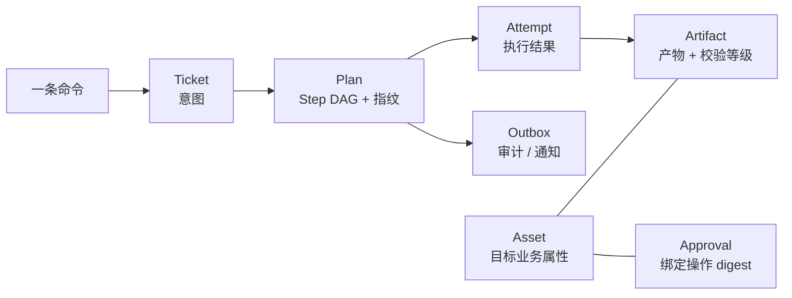

`inspect`、`providers` 不写控制库；`backup` 写 Plan/Attempt/Artifact；`verify` 把校验等级升级到 V2；`restore` 读 Asset 与 Approval 做门禁。退出码含义：`0` 成功、`1` 执行失败、`2` 用法错误或门禁拒绝、`3` 连接失败、`4` plan/probe 失败。

## 2. 第 1 步：`inspect` —— 先确认在对谁操作

```sh
export BKAGENT_DSN='postgres://postgres@127.0.0.1:55416/bk_tut'
bkagent inspect --format text
```

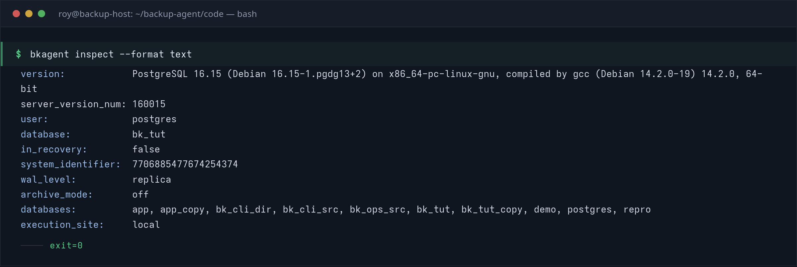

下列字段的用途超出「确认版本」本身：

| 字段 | 为什么关心 |
|---|---|
| `version` / `server_version_num` | 决定可用的备份方式与参数，也用于判断目标是否在支持矩阵（14–17）内 |
| `system_identifier` | 实例身份。计划指纹绑定它，换实例（重建、主备切换）会让既有计划指纹失配 |
| `in_recovery` | 备库为 `true`；在备库上做物理备份与 PITR 的前提不同 |
| `wal_level` / `archive_mode` | 逻辑备份不需要；物理备份、PITR、WAL-G 链路分别要求 `replica`/`logical` 与开启归档 |
| `execution_site` | `local` 表示在本机 spawn；远端执行时显示 `ssh:` / `kubectl:` 前缀 |
| `databases` | 同实例上有哪些库，写 `--database` 时不要写错 |

请全程统一写 `127.0.0.1`：接下来登记的资产 `targetId` 必须与计划算出的字符串完全一致，主机名写法不同会被当成两个目标。

## 3. 第 2 步：`asset-set` —— 给目标建档

资产（Asset）是目标的业务属性：环境、负责人、关键级别、数据分级、RPO、RTO。它不是可选的备注，而是三件事的输入：恢复门禁判断是否属于生产、`watchdog` 判断告警等级、`asset-rpo` 判断恢复点是否过期。

```sh
bkagent asset-set --target 127.0.0.1:55416/bk_tut --engine postgres \
  --environment production --owner dba --criticality high \
  --data-classification internal --rpo-minutes 1440 --rto-minutes 240
```

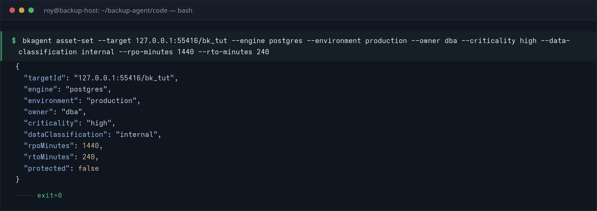

`targetId` 不是自由文本，由 `<host>:<port>/<database>` 三段拼成，必须与计划计算结果逐字符相同：

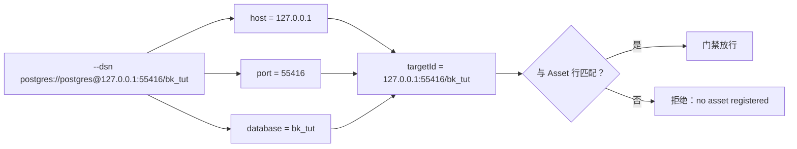

三个容易错的地方：

- 用 `localhost` 登记、用 `127.0.0.1` 备份，会被算成两个目标。
- 恢复时 `--database` 是**目标库名**，与备份来源库名不同，`targetId` 也随之改变；换库名恢复要为新库单独登记。
- 已存在的资产要「变宽松」（降低关键级别、去掉 `--protected`、改环境）时，必须再加 `--yes --principal <id>`，否则被拒。

## 4. 第 3 步：`providers` —— 确认可用链路

```sh
bkagent providers --format text
```

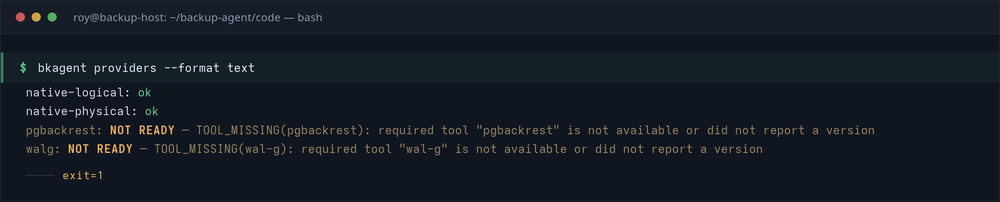

```text
native-logical: ok
native-physical: ok
pgbackrest: NOT READY — TOOL_MISSING(pgbackrest): required tool "pgbackrest" is not available or did not report a version
walg: NOT READY — TOOL_MISSING(wal-g): required tool "wal-g" is not available or did not report a version
```

这段输出需要正确解读，否则会误判为故障：

- 本机未安装 `pgbackrest` 与 `wal-g`，因此两条链路为 `NOT READY`，命令以退出码 `1` 结束。这是**能力协商（capability negotiation）失败关闭**：未声明的能力会明确报错，不会静默降级成 `pg_dump`。
- `native-logical`、`native-physical` 为 `ok`，只说明 `pg_dump` / `pg_basebackup` 可用，不代表版本匹配已通过；真正的版本与参数校验在执行时按计划逐步进行。
- 只关心逻辑备份时，这两行 `NOT READY` 可以忽略；但只要计划里出现 `pgbackrest-*` / `walg-*` 步骤，就必须先让对应工具出现在 `PATH` 上（或显式传 `--walg <bin>`）。

## 5. 第 4 步：`backup` —— 产出第一个恢复点

```sh
bkagent backup --database bk_tut --out /var/backups/bk_tut.dump --format custom
```

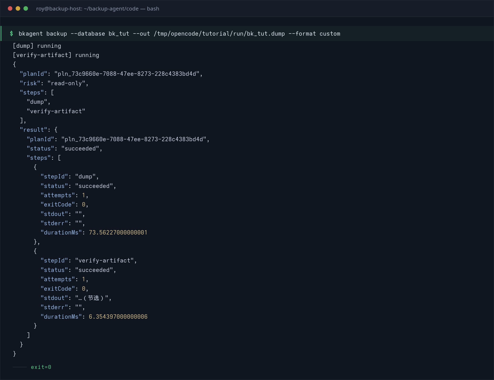

```text
[dump] running
[verify-artifact] running
{
  "planId": "pln_73c9660e-7088-47ee-8273-228c4383bd4d",
  "risk": "read-only",
  "steps": ["dump", "verify-artifact"],
  "result": {
    "planId": "pln_73c9660e-7088-47ee-8273-228c4383bd4d",
    "status": "succeeded",
    ...
```

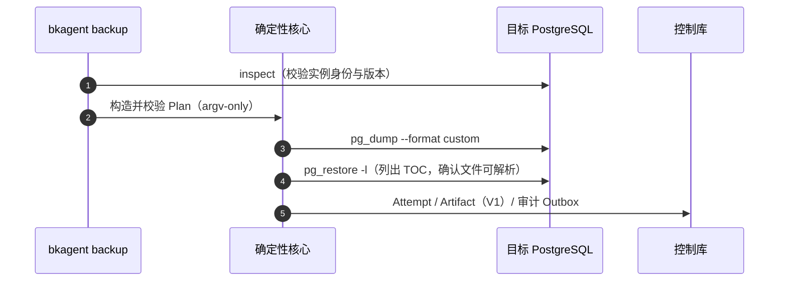

要点：

- 一次逻辑备份是两个步骤：`dump` 与 `verify-artifact`。第二步用 `pg_restore -l` 读取目录（TOC），解析成功即说明归档文件完整，产物记为 **V1**（包含大小与 SHA256 摘要）。
- `risk` 是 `read-only`：备份不修改目标数据，因此不需要 `--yes`、不需要资产、不需要审批。
- 产物默认落在 `--out` 指定路径；`--storage-kind fs|nfs|s3` 可让核心上传后再登记，`--remove-local` 删除本地副本。凭据同样只走环境变量（`BKAGENT_S3_*`）。
- 常用变体：`--format directory --jobs 4`（并行、可按表恢复）、`--format plain`（纯 SQL，便于人工查看）、`--mode physical`（`pg_basebackup`，需要 `replication` 权限与 `wal_level=replica`）。

## 6. 第 5 步：`verify` —— 把 V1 升级为 V2

V1 仅证明归档文件可写出。要证明备份可恢复且数据一致，必须实际执行一次恢复：

```sh
bkagent verify --input /var/backups/bk_tut.dump --database bk_tut
```

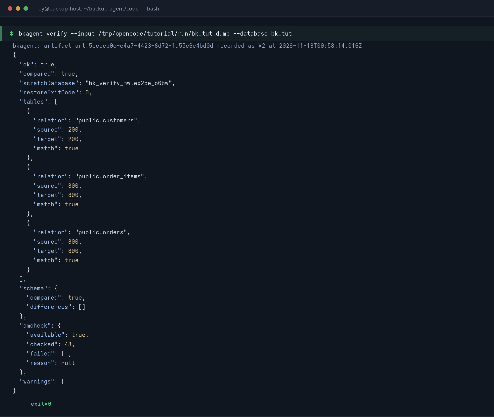

```json
{
  "ok": true,
  "compared": true,
  "scratchDatabase": "bk_verify_mwlex2be_o6bw",
  "restoreExitCode": 0,
  "tables": [
    { "relation": "public.customers", "source": 200, "target": 200, "match": true },
    { "relation": "public.order_items", "source": 800, "target": 800, "match": true },
    { "relation": "public.orders", "source": 800, "target": 800, "match": true }
  ],
  "schema": { "compared": true, "differences": [] },
  "amcheck": { "available": true, "checked": 48, "failed": [], "reason": null },
  "warnings": []
}
```

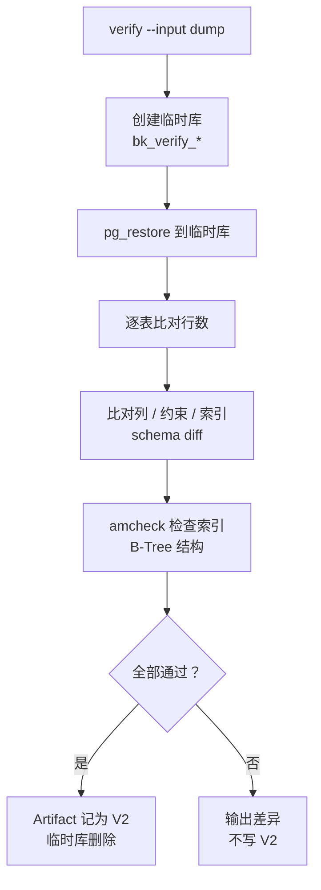

校验等级决定「该恢复点是否可用」：

| 等级 | 含义 | 写入者 |
|---|---|---|
| V0 | 产物存在且命令成功 | `backup`（物理备份的 `pg_verifybackup` 计划内校验） |
| V1 | 已记录大小与内容摘要 | `backup` |
| V2 | 恢复到临时库后比对行数、schema 与 `amcheck` | `verify` 实际执行通过 |
| V3 | 业务冒烟 SQL 断言 | 尚未实现（用例集缺失） |

等级不能靠声明获得：`artifact-add --verified-level V2` 必须同时给出 64 位十六进制 `--checksum`；`verify` 仅在完整执行比对后才写回 V2。`--keep-scratch` 保留临时库用于排查，默认删除。

## 7. 第 6 步：查看台账

```sh
bkagent catalog
bkagent asset-rpo
```

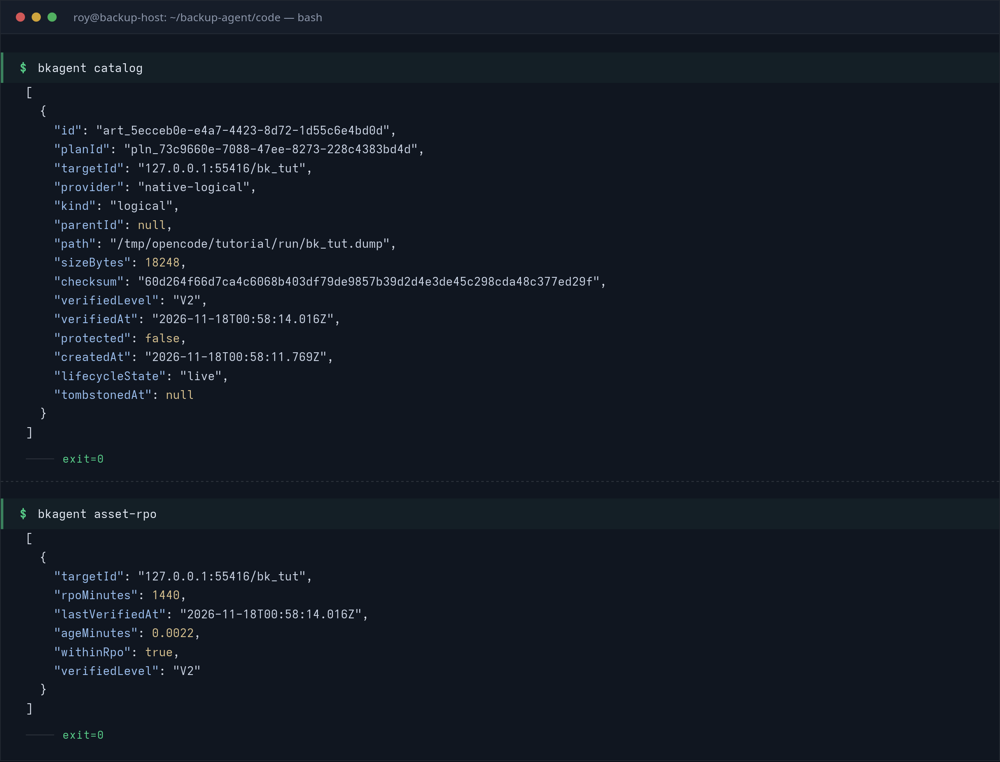

```json
[
  {
    "id": "art_5ecceb0e-e4a7-4423-8d72-1d55c6e4bd0d",
    "targetId": "127.0.0.1:55416/bk_tut",
    "provider": "native-logical",
    "kind": "logical",
    "path": "/tmp/opencode/tutorial/run/bk_tut.dump",
    "sizeBytes": 18248,
    "checksum": "60d264f66d7ca4c6068b403df79de9857b39d2d4e3de45c298cda48c377ed29f",
    "verifiedLevel": "V2",
    "lifecycleState": "live",
    ...
  }
]
```

需要重点关注三个字段：`verifiedLevel`（V2 才有恢复价值）、`lifecycleState`（`live` / `tombstoned`，保留策略只打墓碑不删文件）、`checksum`（与远端存储副本比对时使用）。

`asset-rpo` 换个角度回答「我现在有没有达标的恢复点」：`ageMinutes` 是最近一次 V2 的年龄，`withinRpo` 与资产登记的 `--rpo-minutes` 比较。巡检脚本通常直接读取这两个字段。

`report` 输出面向人的汇总，`metrics` 输出 Prometheus 文本格式的时间序列：

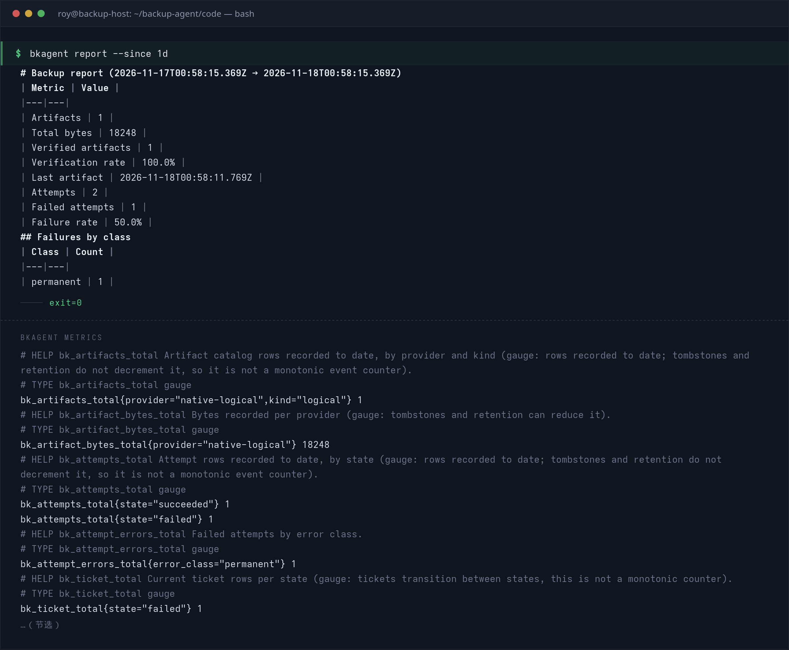

一处容易误读的行为：被门禁拒绝的恢复同样写入一条 `Attempt`（错误类 `permanent`），因此 `report` 的失败率包含「门禁拒绝」。失败率高不代表备份异常，应先查看 `## Failures by class`。

## 8. 第 7 步：`restore` —— 三重门禁

逻辑恢复一律按破坏性操作处理：输入的 SQL 可能含 `DROP`，`--clean` 更会先清空目标库对象。门禁按顺序求值，任一条件不满足即拒绝，并打印下一条应执行的命令。

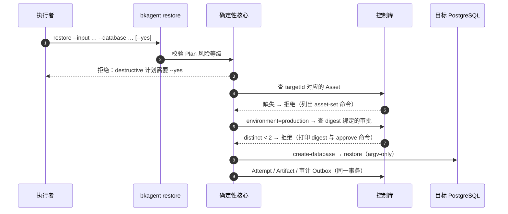

### 8.1 第 1 道：`--yes`

```sh
bkagent restore --dsn 'postgres://postgres@127.0.0.1:55416/postgres' \
  --input /var/backups/bk_tut.dump --database bk_tut_restore --create-database
```

```text
bkagent: plan risk is destructive for target "127.0.0.1:55416/bk_tut_restore"; re-run with --yes to proceed
```

计划本身声明了 `risk: destructive`，缺 `--yes` 直接拒绝。这一步不是提示语，是硬性检查：风险等级由 `DESTRUCTIVE_PLAN_COMMANDS` 决定，计划若低报风险会被判 `risk-understated` 并拒绝。

### 8.2 第 2 道：资产必须已登记

加上 `--yes` 后，`targetId` 变成 `127.0.0.1:55416/bk_tut_restore`——注意不是来源库 `bk_tut`：

```text
bkagent: no asset registered for target "127.0.0.1:55416/bk_tut_restore" in control database "/tmp/opencode/tutorial/run/control.db". Register it before destructive work:
  bkagent asset-set --db /tmp/opencode/tutorial/run/control.db --target 127.0.0.1:55416/bk_tut_restore --engine postgres --environment <production|staging|development|test> --owner <owner> --criticality <critical|high|medium|low> --data-classification <public|internal|confidential|restricted> --rpo-minutes <n> --rto-minutes <n> [--protected]
```

拒绝信息中包含修复命令，可直接复制执行。这里也是「环境」字段第一次产生实际后果的分岔点：登记为 `production` 会触发第 3 道门禁。

### 8.3 第 3 道：生产目标需要双人复核

按提示把 `bk_tut_restore` 登记为 `production` 后重试：

```sh
bkagent asset-set --target 127.0.0.1:55416/bk_tut_restore --engine postgres \
  --environment production --owner dba --criticality high \
  --data-classification internal --rpo-minutes 1440 --rto-minutes 240
```

```text
bkagent: production-destructive plan on target "127.0.0.1:55416/bk_tut_restore" requires 2 distinct approvals; have 0.
digest: d6861131af1c512044d482270cf24a78e26016de757577832632eaf486600e2a
approve: bkagent approve --db … --target 127.0.0.1:55416/bk_tut_restore --digest d686… --approver <id>
inspect: bkagent approvals --db … --target 127.0.0.1:55416/bk_tut_restore --digest d686…
```

三次拒绝都以退出码 `2` 结束，脚本里可以据此判断「被门禁挡住」而不是「执行失败」。

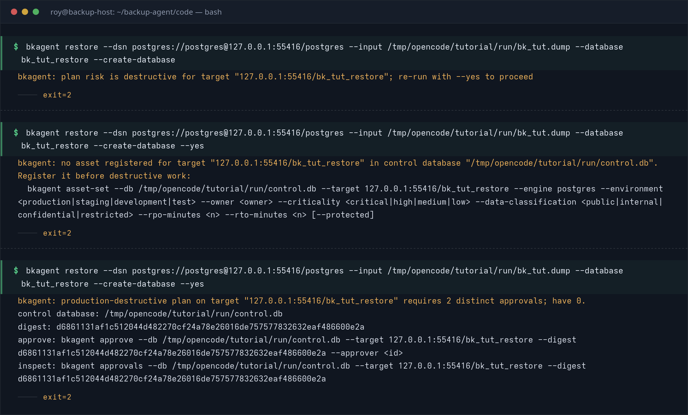

审批绑定的是 **digest**，不是目标名：digest 由操作内容（计划指纹、配置摘要）算出，改了输入文件或参数就要重新审批。审批窗口 60 分钟。

审批按**操作系统身份**去重，这是最容易被绕过的错觉：

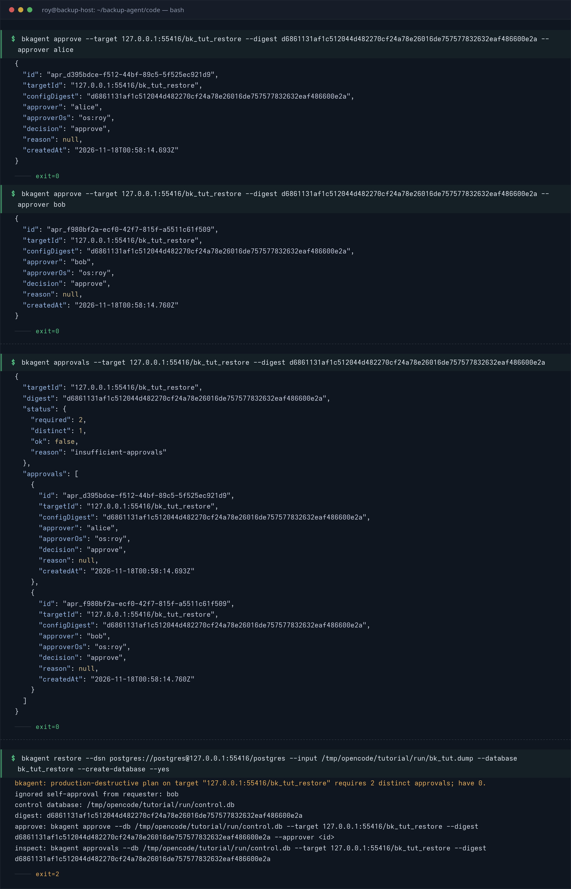

```json
{
  "targetId": "127.0.0.1:55416/bk_tut_restore",
  "digest": "d6861131af1c512044d482270cf24a78e26016de757577832632eaf486600e2a",
  "status": { "required": 2, "distinct": 1, "ok": false, "reason": "insufficient-approvals" },
  "approvals": [
    { "approver": "alice", "approverOs": "os:roy", "decision": "approve" },
    { "approver": "bob",   "approverOs": "os:roy", "decision": "approve" }
  ]
}
```

两个标签、同一个 OS 用户，`distinct` 仍然是 `1`，门禁不放行；再次执行时连请求者自己的审批也会被忽略，并打印 `ignored self-approval from requester: bob`。要真正满足双人复核，必须由第二个操作系统用户执行 `approve`。

### 8.4 一次通过

非生产目标只需要 `--yes`。登记一个 `test` 环境的目标后重试：

```sh
bkagent asset-set --target 127.0.0.1:55416/bk_tut_copy --engine postgres \
  --environment test --owner dba --criticality medium \
  --data-classification internal --rpo-minutes 2880 --rto-minutes 480
bkagent restore --dsn 'postgres://postgres@127.0.0.1:55416/postgres' \
  --input /var/backups/bk_tut.dump --database bk_tut_copy --create-database --yes
```

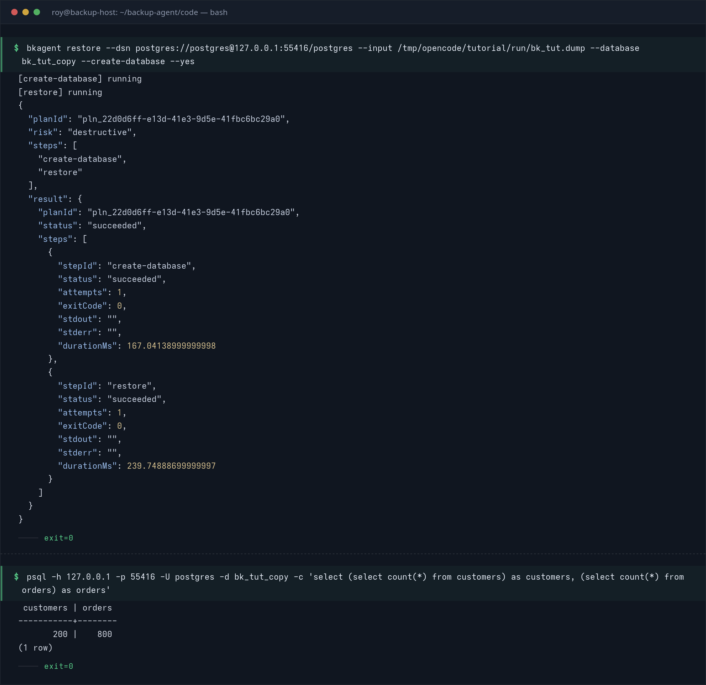

```text
[create-database] running
[restore] running
{
  "planId": "pln_22d0d6ff-e13d-41e3-9d5e-41fbc6bc29a0",
  "risk": "destructive",
  "steps": ["create-database", "restore"],
  "result": { "status": "succeeded", ... }
}
```

恢复命令成功不代表数据一致，需再核对行数：

```sh
psql -h 127.0.0.1 -p 55416 -U postgres -d bk_tut_copy \
  -c 'select (select count(*) from customers) as customers, (select count(*) from orders) as orders'
```

```text
 customers | orders
-----------+--------
       200 |    800
(1 row)
```

该人工核对与 `verify` 的职责重叠，但两者的校验对象不同：`verify` 校验的是**备份文件**能否恢复且一致，这一步校验的是**这次恢复操作**落到了正确的库。

拒绝信息与下一步，对照表：

| 现象 | 原因 | 下一步 |
|---|---|---|
| `plan risk is destructive … re-run with --yes` | 缺 `--yes` | 加 `--yes`，先确认目标库名 |
| `no asset registered for target …` | 目标未登记，或 `host`/`port`/库名不一致 | 按拒绝信息中的 `asset-set` 执行 |
| `requires 2 distinct approvals; have 0` | 生产目标，审批不足 | 按打印的 `digest` 让第二个 OS 用户 `approve` |
| `ignored self-approval from requester …` | 同一 OS 用户重复审批 | 换第二个操作系统用户 |
| `config drift` / 指纹失配 | 目标实例或配置在计划生成后发生变化 | 重新执行 `inspect` 确认身份，再重新发起 |

## 9. 观测：`dashboard` 与 `watchdog`

只读面板不连目标库，只读控制库：

```sh
bkagent dashboard --out /var/www/bkagent.html     # 生成自包含 HTML
bkagent dashboard --serve --port 8787             # 只绑定 127.0.0.1
```

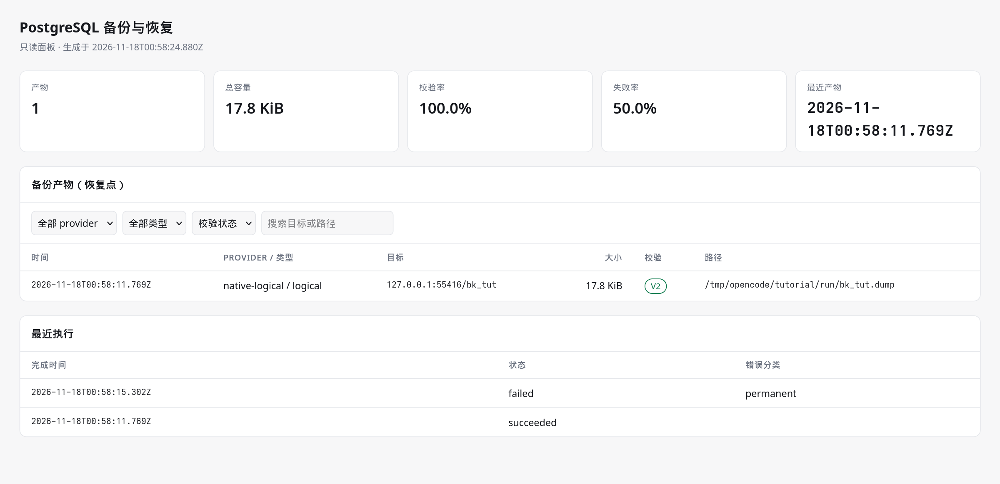

面板内容全部来自控制库，字段经 HTML 转义；`--serve` 仅绑定 `127.0.0.1`，要对外开放请自行套反向代理并加认证。

告警走 `watchdog`，按 P1–P4 阶梯评估，先做一次对账（启动时残留的 `running` 会被判 `stalled`）：

```sh
bkagent watchdog
```

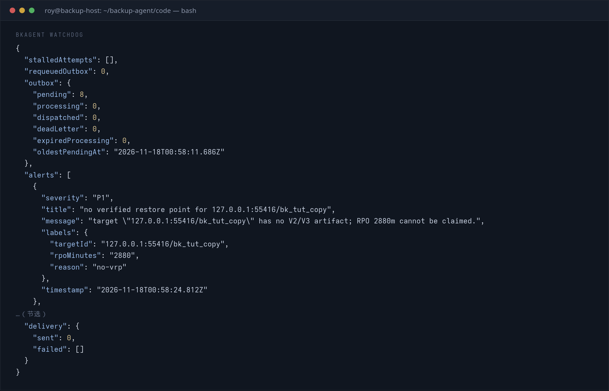

上述两条 P1 告警的成因是：`bk_tut_restore` 与 `bk_tut_copy` 被登记为**需备份的资产**，但没有 V2 产物，因此判定为 `no-vrp`。由此得到的约束是：恢复用的临时目标不应登记为长期资产，否则该目标会进入 RPO 统计范围。真实巡检里，`watchdog` 的输出适合直接接 `BKAGENT_WEBHOOK_URL` / SMTP，投递失败会留在 Outbox 里，用 `outbox-dispatch` 重投。

## 10. 进阶：三条继续往前的路

主线验证通过后，按目标从下列三条路径中选择一条继续，无需逐条阅读 34 条命令。

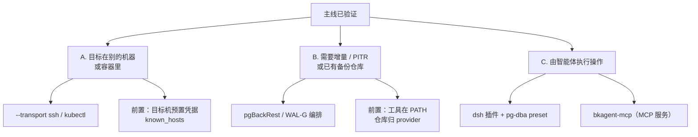

| 路线 | 入口 | 必须先满足 | 本教程状态 |
|---|---|---|---|
| 远端执行 | 目标类命令加 `--transport ssh` 或 `--transport kubectl` | `--ssh-host` + `--known-hosts`（强制 `BatchMode=yes`、`StrictHostKeyChecking=yes`），或 `--kubectl-pod`；凭据预置在目标机 | 未在本教程演示 |
| provider 链路 | `pgbackrest-backup\|restore\|expire`、`walg-backup\|restore\|prune` | 对应工具在 `PATH` 上且版本可探测 | 未演示，本机 `providers` 报 `TOOL_MISSING` |
| 智能体面 | `packages/dsh-plugin`、`presets/pg-dba/`、`bkagent-mcp` | `pnpm build:cli` 产出 `dist/bkagent.mjs`；安装脚本 `scripts/install-dsh.sh` | 已安装并通过预设加载验证（见 10.1） |

三条共同的硬约束：

- 远端传输**不转发环境变量**：带 env 的计划在执行前被拒绝，密码必须由目标机的 `.pgpass` / peer / GSSAPI 提供。
- 远端产物的路径记为 `<transport>:<path>`，表示字节位于目标机、控制面无法读取，因此 `verify --input` 不能直接使用该路径。
- provider 的备份仓库归 provider 所有，保留操作仅能通过 `pgbackrest expire` / `wal-g delete retain` 执行；bkagent 只做编排与台账。
- MCP 模式下破坏性工具失败关闭，默认不会因「智能体要求」而绕过门禁。

### 10.1 把 bkagent 装成 dsh 插件

dsh 0.2.x 改了两处与本项目相关的机制：profile 由「有序的 bundle patch 层」组合，`dsh plugin add` 只负责把包装进 profile；预设不再是 `$DSH_HOME/.agent-presets/` 下的目录，而是 bundle patch 里的一条 `@deepseek-ai/dsh-agent-preset` 行。仓库已经适配：[`packages/dsh-plugin/package.json`](https://github.com/RoyDD/backup-agent/blob/main/packages/dsh-plugin/package.json) 声明 `dsh.bundle`，[`packages/dsh-plugin/cordis.patch.yml`](https://github.com/RoyDD/backup-agent/blob/main/packages/dsh-plugin/cordis.patch.yml) 提供 `pg-dba` 预设。

```sh
dsh --version                       # 需要 0.2.x；本文验证于 0.2.2-rc.4
bash scripts/install-dsh.sh web     # 或指定其他 profile 名
```

脚本执行四个步骤：

1. `pnpm build:cli`、`pnpm build:knowledge` 产出两个单文件包；
2. `var/knowledge.sqlite` 不存在时重建知识索引；
3. `dsh plugin --profile web add link:<repo>/packages/dsh-plugin`；插件声明了 `dsh.bundle`，`add` 会同时把它写入 profile 的 bundle 列表；
4. 预设随补丁层挂载，不再复制目录。

以下两项验证缺一不可：

```sh
dsh --profile web --dump-config | grep -A2 preset-pg-dba   # 补丁层是否生效
dsh --profile web --no-open                                # 设置 → Agent 预设
```

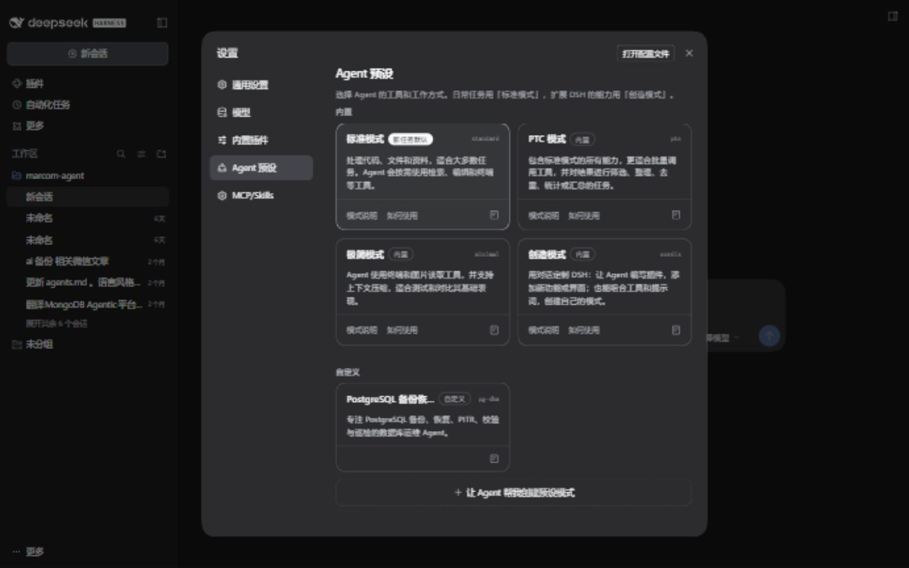

设置页出现「自定义 / PostgreSQL 备份恢复」，且没有「加载失败」，说明预设内每一行（persona、`@backup-agent/dsh-plugin`、技能目录）都已激活；此后新建会话并选用该预设，即可使用 `pg_inspect`、`pg_backup`、`pg_restore`、`pg_pitr`、`pg_verify`、`pg_catalog`、`pg_report` 与 `kb_search`。

安装过程中实际遇到的三个问题：

| 现象 | 原因 | 处理 |
|---|---|---|
| 装完插件页有 `@backup-agent/dsh-plugin`，但预设列表里没有 | 包没有声明 `dsh.bundle`，`add` 只把它当普通依赖 | 在 `package.json` 加 `dsh.bundle.patch`，重新 `remove` 后 `add` |
| 预设显示「加载失败」，提示 `$.prefix missing required value` | 0.2.x 的 persona 行要求 `prefix`，0.1.x 的 `text` 不再接受 | 改写为 `prefix`；`{{…}}` 变量必须是已注册的，否则同样报错 |
| 手工把预设目录复制到 `~/.dsh/.agent-presets/` 无效 | 0.2.x 不再读取该目录 | 改为 bundle patch 的 `@deepseek-ai/dsh-agent-preset` 行 |

不使用 dsh 时，可继续使用 MCP 入口：

```sh
BKAGENT_CLI=$PWD/dist/bkagent.mjs node packages/dsh-plugin/mcp.js
```

MCP 没有审批通道，`pg_restore` / `pg_pitr` 一律失败关闭，返回 `isError` 并提示改用 preset 或 CLI。

## 11. 出问题时的查找顺序

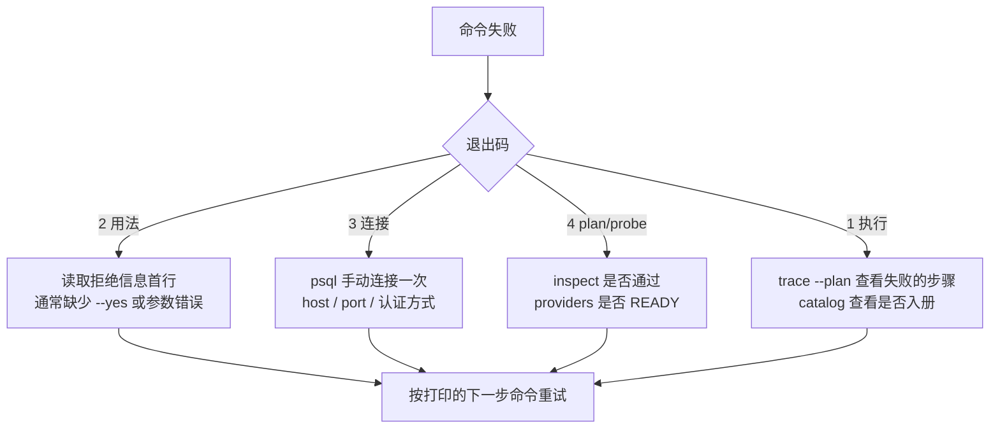

| 现象 | 原因 | 处理 |
|---|---|---|
| `no such table: …` 启动即报 | 控制库已存在，但迁移目录缺失（单文件安装常见） | 设 `BKAGENT_MIGRATIONS` 指向包内 `dist/migrations`，或在旧控制库上重新执行迁移 |
| `no asset registered for target …` | 目标未登记，或 `host` / `port` / 库名与 `targetId` 不一致 | 按拒绝信息中的 `asset-set` 执行，并统一使用 `127.0.0.1` |
| `TOOL_MISSING(pgbackrest)` | 工具不在 `PATH` 上 | 安装或改走 `native-logical`，不要期待自动降级 |
| `connection refused` / 退出码 `3` | 连接串、端口或认证失败 | 先用 `psql` 同参数手连一次，再回到 bkagent |
| `pg_verifybackup` 找不到 | 位于 `/usr/lib/postgresql/<ver>/bin`，默认不在 `PATH` | 加入 `PATH`，或改用 `--format tar` 并接受 V0 缺失 |
| `dashboard --serve` 打不开 | 只绑定 `127.0.0.1` | 本机访问，或自建反向代理并加认证 |

排查顺序建议固定为：`inspect` → `providers` → `trace --plan` → `catalog` → `watchdog`。`trace` 用 `--ticket` 或 `--plan` 定位单次执行，可查看每一步的 argv 与退出码。

## 12. 附录：主线命令卡

```sh
# 0. 环境
export BKAGENT_DSN='postgres://<user>@127.0.0.1:5432/<db>'
export BKAGENT_DB=.bkagent/control.db      # 缺省值，可省略

# 1. 探测
bkagent inspect --format text
bkagent providers --format text

# 2. 建档（targetId 必须是 <host>:<port>/<database>）
bkagent asset-set --target 127.0.0.1:5432/<db> --engine postgres \
  --environment production --owner dba --criticality high \
  --data-classification internal --rpo-minutes 1440 --rto-minutes 240

# 3. 备份与校验
bkagent backup --database <db> --out /var/backups/<db>.dump --format custom
bkagent verify --input /var/backups/<db>.dump --database <db>

# 4. 台账
bkagent catalog
bkagent asset-rpo
bkagent report --since 7d
bkagent metrics

# 5. 恢复（先确认目标库名，再决定环境）
bkagent asset-set --target 127.0.0.1:5432/<db>_copy --engine postgres \
  --environment test --owner dba --criticality medium \
  --data-classification internal --rpo-minutes 2880 --rto-minutes 480
bkagent restore --dsn 'postgres://<user>@127.0.0.1:5432/postgres' \
  --input /var/backups/<db>.dump --database <db>_copy --create-database --yes

# 6. 观测
bkagent watchdog
bkagent dashboard --out /var/www/bkagent.html
```

## 13. 这份教程验证到什么程度

如实说明边界，避免将「未执行」记为「已通过」：

| 内容 | 状态 |
|---|---|
| `inspect`、`providers`、`asset-set`、`backup --mode logical`、`verify`、`catalog`、`asset-rpo`、`report`、`metrics`、`restore`（含三次门禁拒绝与一次通过）、`approve`、`approvals`、`watchdog`、`dashboard --out` | 在本地 PostgreSQL 16.15 上实际执行，输出为真实回显 |
| dsh 0.2.2-rc.4 安装、插件挂载与 `pg-dba` 预设 | 已执行：`--dump-config` 出现 `preset-pg-dba`，设置页显示「自定义 / PostgreSQL 备份恢复」且无加载失败；未用模型实际发起一次会话 |
| 双人复核的**通过态** | 未演示：需要第二个操作系统用户执行 `approve`，本教程只展示 `distinct: 1` 的拒绝与自审被忽略 |
| `--transport ssh` / `--transport kubectl`、物理备份、PITR、`pgbackrest-*`、`walg-*`、`retain`、MCP 入口 | 未执行，只给入口与前置条件 |
| V3 校验等级 | 未实现 |

相关的离线验收（E-08）与真实模型端到端（E-09）尚未纳入发布准入检查，当前完成度以 [status.md](status.md) 为准。
