# bkagent 使用手册

本手册面向在单机或远端 PostgreSQL 实例上执行备份、校验、恢复与巡检的 DBA。内容包括命令入口、门禁条件、可验证的实操示例与排障路径；设计原理与未达成条目不在本文件展开，见 [architecture.md](architecture.md) 与 [status.md](status.md)。

首次接触本项目时，建议先阅读 [tutorial.md](tutorial.md)：该教程以一个可复现的演示库为对象，依次执行「探测 → 登记 → 备份 → 校验 → 恢复 → 观测」，并说明每一步的必要性。本文件是参考手册，回答「某条命令有哪些参数、门禁如何计算」。

约定：

- 命令统一以 `bkagent` 表示。开发态用 `pnpm bkagent`，发布产物为 `node dist/bkagent.mjs`，两者参数完全一致。
- 示例 DSN 使用 `postgres://<user>@127.0.0.1:55416/app`，密码不出现在 argv，见 §4.11。
- 本文截图取自本地演练环境（PostgreSQL 16.15，控制库为临时 SQLite）。行数、大小与时间戳随环境变化，命令与字段名不变。

## 1. 三分钟上手

最小可用路径是「探测 → 登记资产 → 备份 → 校验 → 看台账」。`asset-set` 只对恢复（破坏性操作）强制，但提前登记能让 `watchdog`、`asset-rpo` 与双人复核直接可用。

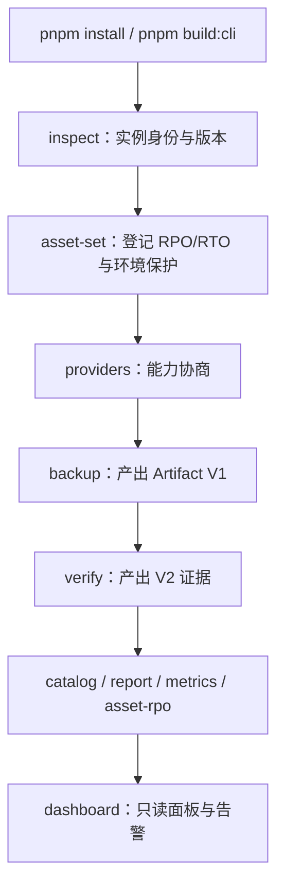

```sh
pnpm install
pnpm build:cli

export BKAGENT_DSN='postgres://backup@127.0.0.1:55416/app'
node dist/bkagent.mjs inspect  --format text
node dist/bkagent.mjs asset-set --db .bkagent/control.db \
  --target 127.0.0.1:55416/app --engine postgres --environment production \
  --owner dba --criticality high --data-classification internal \
  --rpo-minutes 1440 --rto-minutes 240
node dist/bkagent.mjs backup  --database app --out /var/backups/app.dump \
  --format custom --db .bkagent/control.db
node dist/bkagent.mjs verify  --input /var/backups/app.dump --database app --db .bkagent/control.db
node dist/bkagent.mjs catalog --db .bkagent/control.db
```

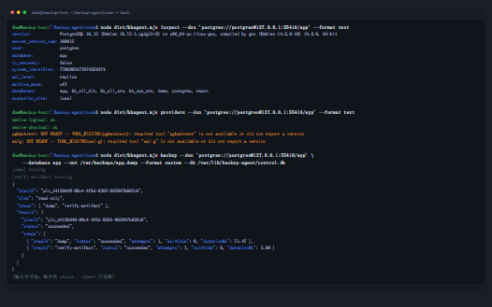

上图三条命令依次为实例探测、provider 就绪性探测与一次逻辑备份。`pgbackrest` / `walg` 报 `TOOL_MISSING` 表示工具不在 `PATH` 上，属预期：未声明的能力会在计划阶段失败关闭，不会静默降级为 `pg_dump`。

`--target` 的取值不是自由文本，而是 `<host>:<port>/<database>`，必须与计划计算出的 `targetId` 完全一致，否则恢复门禁会以「资产未登记」拒绝。

## 2. 概念模型

一次操作在控制库里留下五类持久对象：`Ticket`（意图）、`Plan`（Step DAG 与指纹）、`Attempt`（执行记录）、`Artifact`（产物与校验等级）、`Asset`（目标资产的业务属性）。`Approval` 绑定「操作 digest」，`Outbox` 承载审计、通知与血缘投递。

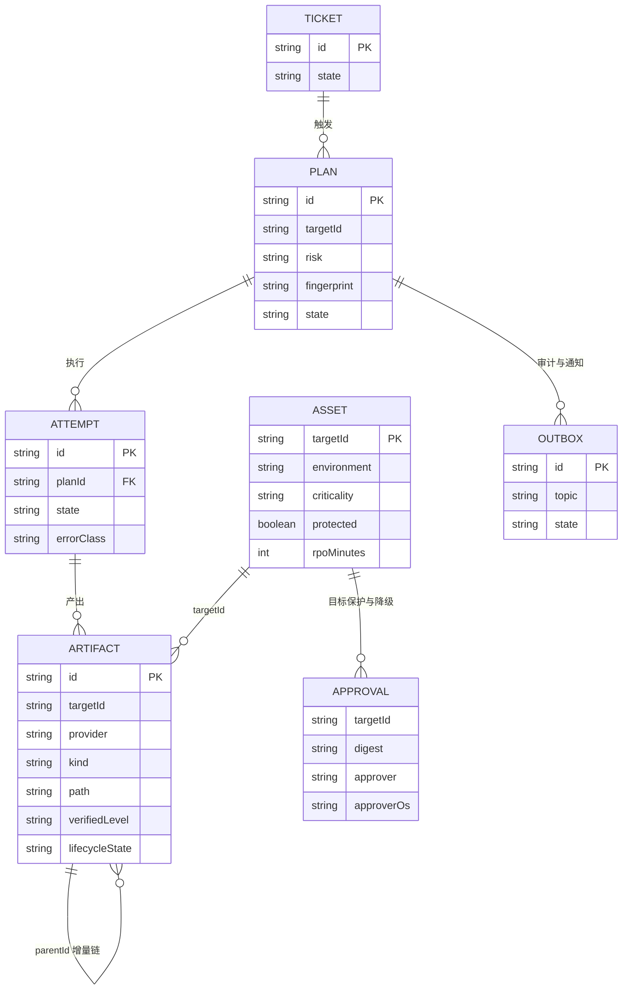

校验等级决定「这条恢复点能不能用」：

| 等级 | 含义 | 写入者 |
|---|---|---|
| V0 | 产物存在且命令成功（如物理备份的 `pg_verifybackup` 计划内校验） | `backup` 自身 |
| V1 | 已记录大小与内容摘要 | `backup` 上传或落盘后 |
| V2 | 恢复到临时库后比对行数、schema 与 `amcheck` | `verify` 实际执行通过 |
| V3 | 业务冒烟 SQL 断言 | 尚未实现（用例集缺失） |

V2/V3 不会因为「声明」而存在：`artifact-add --verified-level V2` 必须同时给出 64 位十六进制 `--checksum`，`verify` 则只有真正跑完比对才写入等级。等级只写回「路径完全相同」的最近一行，未入册的输入只打印结果并提示。

## 3. 命令地图

34 个命令按用途分成八组，先按意图选组，再查 §8 附录 A 的完整参数。

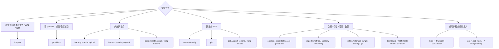

| 组 | 命令 | 是否需要控制库 |
|---|---|---|
| 探测 | `inspect`、`providers` | 否（不写控制库） |
| 备份 | `backup`、`pgbackrest-backup`、`walg-backup` | 是（记录 Plan/Attempt/Artifact） |
| 校验 | `verify` | 是（写入 V2 证据需要） |
| 恢复 | `restore`、`pitr`、`pgbackrest-restore`、`walg-restore` | 是（门禁依赖 Asset 与 Approval） |
| 清理 | `retain`、`storage-purge`、`storage-gc`、`pgbackrest-expire`、`walg-prune` | 是 |
| 观测 | `catalog`、`report`、`metrics`、`capacity`、`watchdog`、`asset-rpo`、`trace`、`outbox-dispatch`、`dashboard`、`notify-test` | 是 |
| 治理 | `asset-set`、`asset-list`、`approve`、`approvals`、`model-policy`、`cost` | 是 |
| 传输 | `exec`（自带 `--host` / `--pod`） | 否 |

`--db` 缺省取 `$BKAGENT_DB`，再缺省为 `.bkagent/control.db`；控制库首次使用会自动跑迁移，新增迁移缺失时启动即报 `no such table`，用 `BKAGENT_MIGRATIONS` 指向迁移目录可修复（单文件安装的典型问题）。

## 4. 场景化操作

### 4.1 实例探测：inspect

`inspect` 通过 `psql` 读实例身份，是所有计划的输入前提：版本矩阵、`system_identifier`、`wal_level`、`archive_mode` 与库清单都在这里。

```sh
bkagent inspect --dsn 'postgres://backup@127.0.0.1:55416/app' --format text
```

```text
version:            PostgreSQL 16.15 (Debian 16.15-1.pgdg13+2) on x86_64-pc-linux-gnu, compiled by gcc (Debian 14.2.0-19) 14.2.0, 64-bit
server_version_num: 160015
user:               postgres
database:           app
in_recovery:        false
system_identifier:  7706885477674254374
wal_level:          replica
archive_mode:       off
databases:          app, bk_cli_dir, bk_cli_src, bk_ops_src, demo, postgres, repro
execution_site:     local
```

要点：

- `execution_site` 为 `local` / `ssh` / `kubectl`，与 `--transport` 一致；远端探测把连接参数作为 argv 传给 `psql`，不带 env。
- `archive_mode: off` 表示实例此刻不归档 WAL：物理备份仍可做，但 `pitr` 的窗口预检会因「最后归档段」缺失而拒绝时间点恢复。
- 探测失败退出 `3`（连接失败），计划/探测结构问题退出 `4`；两者不要与「备份失败」的 `1` 混用。

### 4.2 能力协商：providers

```sh
bkagent providers --dsn 'postgres://backup@127.0.0.1:55416/app' --format text
```

```text
native-logical: ok
native-physical: ok
pgbackrest: NOT READY — TOOL_MISSING(pgbackrest): required tool "pgbackrest" is not available or did not report a version
walg: NOT READY — TOOL_MISSING(wal-g): required tool "wal-g" is not available or did not report a version
```

四个已注册 provider 是 `native-logical` / `native-physical` / `pgbackrest` / `walg`。工具版本以 `--version` 与 SQL 实测为准，不信任配置声明；任一已注册 provider 不可运行，命令退出 `1`，便于在 cron 里当作前置门禁。未声明的能力一律失败关闭，不会静默降级。

### 4.3 逻辑备份：backup

```sh
bkagent backup --dsn 'postgres://backup@127.0.0.1:55416/app' --database app \
  --out /var/backups/app.dump --format custom --db /var/lib/backup-agent/control.db
```

计划固定为两步：`dump`（`pg_dump`）与 `verify-artifact`（读 TOC 确认产物可解析）。成功输出为 `Plan` + 执行结果：

```json
{
  "planId": "pln_d415b048-88c4-4f6d-8505-065847b60fc6",
  "risk": "read-only",
  "steps": ["dump", "verify-artifact"],
  "result": {
    "planId": "pln_d415b048-88c4-4f6d-8505-065847b60fc6",
    "status": "succeeded",
    "steps": [
      { "stepId": "dump", "status": "succeeded", "attempts": 1, "exitCode": 0, "durationMs": 71.47 },
      { "stepId": "verify-artifact", "status": "succeeded", "attempts": 1, "exitCode": 0, "durationMs": 5.98 }
    ]
  }
}
```

格式与用途：

| `--format` | 产物形态 | 说明 |
|---|---|---|
| `custom` | 单文件 | 最常用；可 `--compress` |
| `plain` | SQL 文本 | 便于人工审阅，恢复走 `psql` |
| `directory` | 目录 | 支持 `--jobs` 并行；**不能上传 Storage** |
| `tar` | 单文件 tar | 仅物理模式使用，且跳过 `pg_verifybackup` |

逻辑 `plain` 与物理 `tar` 不写校验等级（`verifiedLevel` 为空）：这两类产物的内容摘要不稳定，用空等级表达「未评估」而不是伪造一个 V。

常用开关：`--table` / `--schema`（可重复）、`--label`、`--mode physical`、`--wal-method stream|fetch`、`--storage-kind fs|nfs|s3 [--storage-root …] [--remove-local]`。给 `--storage-kind` 时产物写入 Storage 并记录位置与 sha256，上传失败整次运行判失败（不会留下读不到的目录行）。

步骤失败时输出里带 `errorClass`，并保留原始 stderr：

```json
{
  "stepId": "dump",
  "status": "failed",
  "attempts": 1,
  "exitCode": 1,
  "errorClass": "permanent",
  "stderr": "pg_dump: error: could not open output file \"/nonexistent-dir/app.dump\": No such file or directory\n"
}
```

`errorClass` 为 `transient` 时按步骤的 `retryOn` 与指数退避重试；`permanent` / `manual` 直接终止并写审计。

### 4.4 物理备份与 PITR 前置

```sh
bkagent backup --dsn 'postgres://backup@127.0.0.1:55416/postgres' \
  --mode physical --out /var/backups/base --format plain --db .bkagent/control.db
```

物理路径用 `pg_basebackup` 产出基础备份，并在计划内执行一次 `pg_verifybackup`（`--format plain` 时），产物记为 `V0`；`--format tar` 明确跳过校验。物理备份没有事后复检入口，需要更强的证据时改用 §4.5 的逻辑校验路径。

PITR 的可恢复窗口只有一项预检：基础备份 `backup_label` 的 consistent point → `pg_stat_archiver.last_archived_wal`。越界即拒绝；WAL 缺口枚举、跨时间线 `.history` 校验与 retention 求交集尚未实现，时间/name/xid 目标由恢复后断言判定：

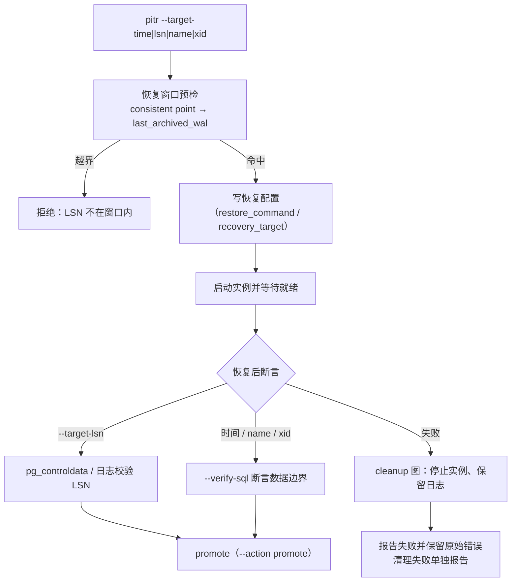

`--action` 可取 `promote` / `pause` / `shutdown`；`--state-dir` + `--resume` 让步骤在中断后从检查点继续（`checkpoint: after` 的步骤会跳过，`none` / `before` 重跑）。不传 `--resume` 时检查点只写不读。

### 4.5 校验：verify 与外部产物入册

`verify` 把转储恢复到临时库，比对行数、schema 与 `amcheck`，通过后把 `V2` 与内容摘要写回「路径完全相同」的目录行：

```sh
bkagent verify --dsn 'postgres://backup@127.0.0.1:55416/postgres' \
  --input /var/backups/app.dump --database app --db .bkagent/control.db
```

```text
bkagent: artifact art_8d3de305-5278-4326-95e5-876227bfa382 recorded as V2 at 2026-11-13T00:55:39.295Z
{
  "ok": true,
  "compared": true,
  "scratchDatabase": "bk_verify_mwe9mhx6_tcfl",
  "restoreExitCode": 0,
  "tables": [
    { "relation": "public.customers", "source": 500, "target": 500, "match": true },
    { "relation": "public.orders", "source": 2000, "target": 2000, "match": true }
  ],
  "schema": { "compared": true, "differences": [] },
  "amcheck": { "available": true, "checked": 46, "failed": [], "reason": null },
  "warnings": []
}
```

- `amcheck` 扩展不可用时返回 `available: false` 并在 `warnings` 说明，此时仍是 `V2`（schema + 行数已比对），但索引物理一致性未验证。
- 输入可以是任意本地 `custom` / `plain` / `-Fd` 目录；`s3://…` 与 `<transport>:<path>` 不可读，会直接报错。
- `--keep-scratch` 保留临时库便于人工排查；默认比对后删除。
- 未入册的路径只打印结果并提示，不写目录——先 `artifact-add` 再 `verify`，或让 `backup` 自己产出该行。

他机/他工具的历史转储用 `artifact-add` 入册。等级是自证：`--verified-level V2 --checksum <sha256>` 只校验 64-hex 格式，不与字节比对。`--provider` 在入册时不做校验，拼错不会当场报错，但 `retain --apply` 会以 `unknown-provider` 整批拒绝，`catalog --provider` 过滤也会对不上——登记时照抄四个已注册 ID。

```sh
bkagent artifact-add --db .bkagent/control.db --target 127.0.0.1:55416/app \
  --provider pgbackrest --kind full --path 's3://backup-repo/main/20261112-020000F' --size 73400320
```

`artifact-upload` 对既有目录行执行同样的 Storage 上传（`--storage-kind fs|nfs|s3 [--storage-root …] [--remove-local]`）。

### 4.6 恢复：restore 与三重门禁

所有逻辑恢复都按破坏性处理，因为输入的 SQL 可能包含 `DROP`。门禁按顺序求值，任一不满足即拒绝并打印下一步命令：

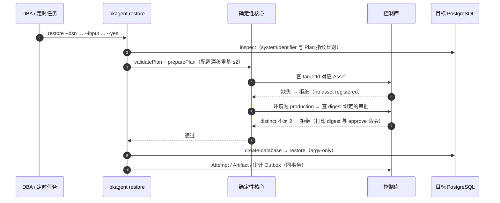

拒绝信息是自解释的，直接照抄下一条命令即可推进：

```text
bkagent: no asset registered for target "127.0.0.1:55416/app_restored" in control database "/tmp/.../control.db". Register it before destructive work:
  bkagent asset-set --db /tmp/.../control.db --target 127.0.0.1:55416/app_restored --engine postgres --environment <production|staging|development|test> --owner <owner> --criticality <critical|high|medium|low> --data-classification <public|internal|confidential|restricted> --rpo-minutes <n> --rto-minutes <n> [--protected]
```

登记为非生产环境后，`--yes` 即通过：

```sh
bkagent asset-set --db .bkagent/control.db --target 127.0.0.1:55416/app_copy \
  --engine postgres --environment test --owner dba --criticality medium \
  --data-classification internal --rpo-minutes 2880 --rto-minutes 480
bkagent restore --dsn 'postgres://backup@127.0.0.1:55416/postgres' \
  --input /var/backups/app.dump --database app_copy --create-database --yes --db .bkagent/control.db
```

```json
{
  "planId": "pln_92fc7c46-56ed-4cb1-8fb1-237178bfde11",
  "risk": "destructive",
  "steps": ["create-database", "restore"],
  "result": {
    "planId": "pln_92fc7c46-56ed-4cb1-8fb1-237178bfde11",
    "status": "succeeded",
    "steps": [
      { "stepId": "create-database", "status": "succeeded", "attempts": 1, "exitCode": 0, "durationMs": 107.29 },
      { "stepId": "restore", "status": "succeeded", "attempts": 1, "exitCode": 0, "durationMs": 151.45 }
    ]
  }
}
```

生产目标多一道双人复核，按**操作系统身份**去重：

```text
bkagent: production-destructive plan on target "127.0.0.1:55416/app_restored" requires 2 distinct approvals; have 0.
digest: 917b5fa238a6020343f20cab68f42b50d5b362ee14acb931706ce09917504a73
approve: bkagent approve --db … --target 127.0.0.1:55416/app_restored --digest 917b… --approver <id>
inspect: bkagent approvals --db … --target 127.0.0.1:55416/app_restored --digest 917b…
```

同一 OS 用户用两个标签审批不会满足要求，`approvals` 会如实显示 `distinct: 1`：

```json
{
  "targetId": "127.0.0.1:55416/app_restored",
  "digest": "917b5fa238a6020343f20cab68f42b50d5b362ee14acb931706ce09917504a73",
  "status": { "required": 2, "distinct": 1, "ok": false, "reason": "insufficient-approvals" },
  "approvals": [
    { "approver": "alice", "approverOs": "os:roy", "decision": "approve" },
    { "approver": "bob", "approverOs": "os:roy", "decision": "approve" }
  ]
}
```

（输出为节选：每行还含 `id`、`targetId`、`configDigest`、`reason`、`createdAt`。）

再次执行会被判为自我审批并明确忽略：`ignored self-approval from requester: bob`。要真正满足双人复核，需要第二个 OS 用户执行 `approve`。审批窗口为 60 分钟，`approvals --ttl-minutes` 只改变查询窗口。

其他开关：`--format custom|directory|plain`、`--clean`、`--if-exists`、`--no-owner`、`--jobs`（仅 directory）、`--state-dir <dir> [--resume]`。`--clean` 会先清空目标库对象，风险等同 `DROP`，与 `--yes` 配合前请确认目标名。

### 4.7 保留与回收：retain、storage-purge、storage-gc

保留策略是 GFS（daily / weekly / monthly）加可达性分析：`keep` 里的行按 `gfs-root`、`vrp-latest` 保留，`remove` 的行给出 `outside-retention`。默认 dry-run，`--apply` 必须绑定 dry-run 打印的 digest：

```sh
bkagent retain --db .bkagent/control.db --daily 7 --weekly 4 --monthly 12 --target 127.0.0.1:55416/app
```

```json
{
  "applied": false,
  "tombstoneOnly": true,
  "bytesReclaimed": 0,
  "policy": { "daily": 7, "weekly": 4, "monthly": 12 },
  "targetId": "127.0.0.1:55416/app",
  "digest": "cf7a09ca3869b778f1010ed2a3961576fb746c47532d64675963dfa7aa37bc85",
  "keep": ["art_4ad6a168-…", "art_8d3de305-…"],
  "remove": ["art_2a193ebc-…"],
  "reasons": {
    "art_4ad6a168-…": "gfs-root",
    "art_8d3de305-…": "vrp-latest",
    "art_2a193ebc-…": "outside-retention"
  }
}
```

digest 不匹配时整批拒绝，不写任何行：

```text
bkagent: retention apply refused (candidate-set-changed): retention candidates for target "127.0.0.1:55416/app" changed since the reviewed dry run.
reviewed digest: deadbeef
current digest:  cf7a09ca3869b778f1010ed2a3961576fb746c47532d64675963dfa7aa37bc85
No rows were changed. Re-run the dry run and pass the new --digest.
```

`retain --apply` 只把目录行标为 tombstone：保留行、路径与 lineage，`bytes` 不回收；`catalog --history` 可见 tombstone，`trace` 仍能沿计划回溯。字节回收由两个独立命令完成，同样先 dry-run 后 `--apply --yes --digest <d>`：

- `storage-purge`：处理「tombstoned + managed + 超过宽限期 + 无 live 子节点」的对象，缺省 `--grace-days 7`，可加 `--target` 收窄。
- `storage-gc`：处理无目录引用且超期的孤儿对象；没有 `--target`（它不是按目标组织的）；外部路径记为 `outside-storage` 跳过，不会误删。

`asset-set --protected` 的 target 整目标豁免，apply 直接拒绝。provider 仓库不在此列：pgBackRest / WAL-G 的保留只能走 `pgbackrest expire` / `wal-g delete retain`（ADR-003），`pgbackrest-expire`、`walg-prune` 是它们的 CLI 入口。

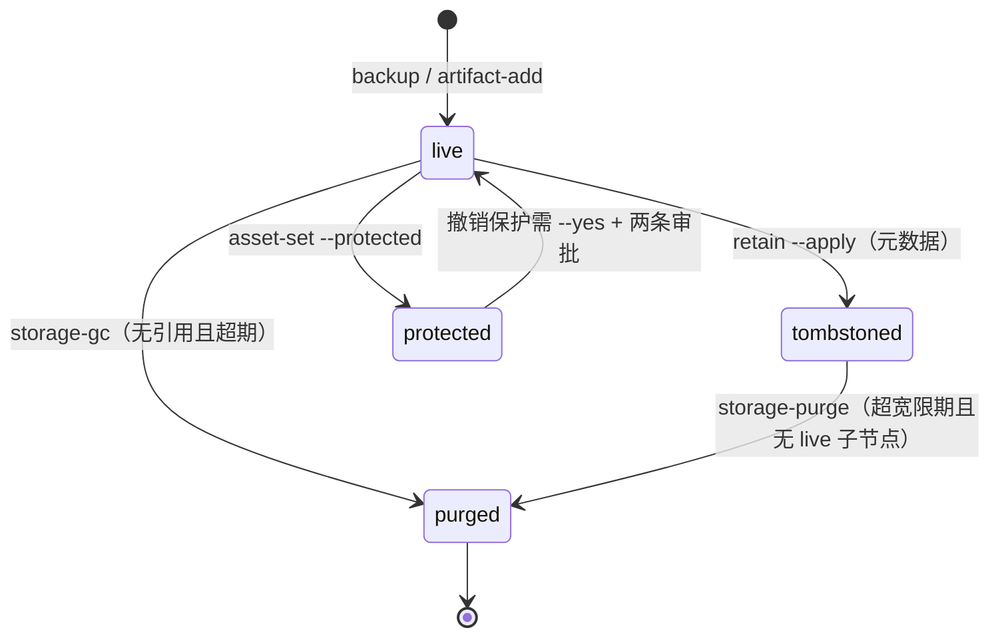

### 4.8 provider 编排：pgBackRest 与 WAL-G

```sh
bkagent pgbackrest-backup  --config /etc/pgbackrest/pgbackrest.conf --stanza main --type full --ensure-stanza --db .bkagent/control.db
bkagent pgbackrest-restore --config /etc/pgbackrest/pgbackrest.conf --stanza main --data-dir /restore \
  --target-type time --target '2026-11-13 02:00:00+08' --start-port 55418 --log /tmp/restore.log --yes
bkagent pgbackrest-expire  --config /etc/pgbackrest/pgbackrest.conf --stanza main --yes
bkagent walg-backup        --data-dir /var/lib/postgresql/data --walg /usr/local/bin/wal-g
bkagent walg-restore       --data-dir /restore --backup LATEST --start-port 55419 --yes
bkagent walg-prune         --retain-full 4 --yes
```

- `pgbackrest-restore` / `walg-restore` 属于破坏性计划，门禁与 §4.6 相同（资产、`--yes`、生产双人复核）；`--start-port` 用于在恢复机上以非默认端口启动实例。
- `--ensure-stanza` 会在备份前创建 stanza；stanza 已存在时是幂等的，重复执行不会重建。
- 两条链路都要求工具在 `PATH` 上或显式传 `--walg`；`providers` 报 `TOOL_MISSING` 时先装工具，而不是绕过能力协商。
- 仓库内容目前只能经 `exec -- pgbackrest info` 查看原始 JSON，不进入 `catalog`；需要入册就用 `artifact-add` 手工登记。

### 4.9 观测：report、metrics、capacity、watchdog、trace

本节覆盖 `report` / `metrics` / `capacity` / `watchdog` / `trace`，以及投递与通道自检的 `outbox-dispatch` / `notify-test`。它们只依赖控制库，不触字节、不连数据库：

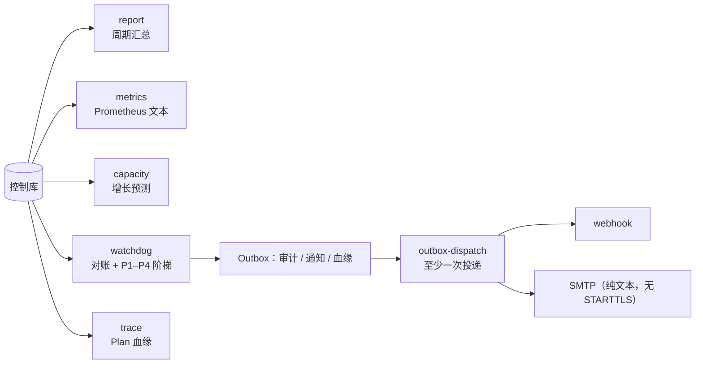

`report` 输出 markdown 汇总（`--format json` 可机读，缺省 `--since 7d`）：

```sh
bkagent report --db .bkagent/control.db --since 7d
```

```markdown
# Backup report (2026-11-06T01:07:37.715Z → 2026-11-13T01:07:37.715Z)

| Metric | Value |
|---|---|
| Artifacts | 4 |
| Total bytes | 160537652 |
| Verified artifacts | 3 |
| Verification rate | 75.0% |
| Last artifact | 2026-11-13T00:56:17.245Z |
| Attempts | 5 |
| Failed attempts | 1 |
| Failure rate | 20.0% |

## Failures by class

| Class | Count |
|---|---|
| permanent | 1 |
```

`metrics` 是 Prometheus 文本格式，共 13 条序列。它们都是**快照型 gauge**，不是单调递增的事件计数器：tombstone 与 retention 会让字节数下降，重启或重建控制库也不会归零重置。

```text
bk_artifacts_total{provider="pgbackrest",kind="full"} 1
bk_artifacts_total{provider="native-physical",kind="full"} 1
bk_artifacts_total{provider="native-logical",kind="logical"} 2
bk_artifact_bytes_total{provider="pgbackrest"} 73400320
bk_artifact_bytes_total{provider="native-physical"} 87103276
bk_artifact_bytes_total{provider="native-logical"} 34056
bk_attempts_total{state="succeeded"} 4
bk_attempts_total{state="failed"} 1
bk_ticket_total{state="failed"} 1
bk_ticket_total{state="succeeded"} 4
bk_attempt_duration_seconds_sum{state="succeeded"} 1.869
bk_attempt_duration_seconds_count{state="succeeded"} 4
```

其余序列：`bk_attempt_errors_total`、`bk_backup_bytes_total`、`bk_verify_result_total`、`bk_outbox_lag_seconds`、`bk_outbox_pending`、`bk_stalled_attempts_total`、`bk_rpo_attainment_ratio`、`bk_last_artifact_timestamp_seconds`。

`capacity` 用最小二乘拟合增速，`--threshold-gb`（缺省 100）给出到达阈值的天数：

```json
{
  "slopePerDay": 251061296.92832765,
  "projectedBytes30d": 7531886379.937883,
  "daysUntilThreshold": 427.68095378143784
}
```

`watchdog` 先对账（把过期 `running` 的 Attempt 标 `stalled`、重投过期租约），再评估 P1–P4 告警阶梯并按配置的通知通道推送：

```json
{
  "stalledAttempts": [],
  "requeuedOutbox": 0,
  "outbox": { "pending": 4, "processing": 0, "dispatched": 0, "deadLetter": 0, "expiredProcessing": 0,
              "oldestPendingAt": "2026-11-13T00:55:33.622Z" },
  "alerts": [],
  "delivery": { "sent": 0, "failed": [] }
}
```

告警阶梯：P1 无可用恢复点 / 无 VRP、P2 连续失败、P3 最近 V2+ 证据超过 7 天、P4 容量逼近阈值。`watchdog` 只告警，不发起校验——「每日抽样 V2、每周 V3」的调度在方案里，代码里没有。

`outbox-dispatch` 把 Outbox 投递到接收端，接收端按 `outbox_id` 去重；未配置任何通知通道时仍会派发审计类 topic：

```json
{ "claimed": 4, "dispatched": 4, "retried": 0, "deadLettered": 0, "unknownTopic": 0, "stale": 0 }
```

`asset-rpo` 判断每个 target 的最近 V2+ 证据是否在 RPO 内：

```json
[
  { "targetId": "127.0.0.1:55416/app",
    "rpoMinutes": 1440,
    "lastVerifiedAt": "2026-11-13T00:55:39.295Z",
    "ageMinutes": 11.97585,
    "withinRpo": true,
    "verifiedLevel": "V2" },
  { "targetId": "127.0.0.1:55416/app_copy",
    "rpoMinutes": 2880,
    "lastVerifiedAt": null,
    "ageMinutes": null,
    "withinRpo": false,
    "verifiedLevel": null }
]
```

已登记但没有 V2+ 证据的目标（如刚建库的 `app_copy`）会以 `withinRpo: false` 出现，这是 `watchdog` 判定 P1 的输入之一。

`trace --plan <id>` / `trace --ticket <id>` 输出 Plan 的完整血缘：指纹、步骤 argv（不含凭据）、依赖、重试策略与 `idempotencyKey`。它同时是审计证据与「计划到底是什么」的最终解释。

`notify-test --url <webhook>` 或 `notify-test --smtp --title '…'` 用于验证通道本身；HTTP 非 2xx 退出 `4`。

### 4.10 只读面板：dashboard

```sh
bkagent dashboard --db /var/lib/backup-agent/control.db --out /var/www/backup/index.html
bkagent dashboard --db /var/lib/backup-agent/control.db --serve --port 8787
```

面板是自包含单文件（内联 CSS/JS，无外部资源、无凭据），五个汇总卡片 + 产物时间线（可过滤）+ 最近执行记录。`--serve` 只绑定 `127.0.0.1`，每个请求重新渲染，适合放在带鉴权的反向代理后面；`--out` 与 `--serve` 同时给出时 `--out` 优先，不启动服务。

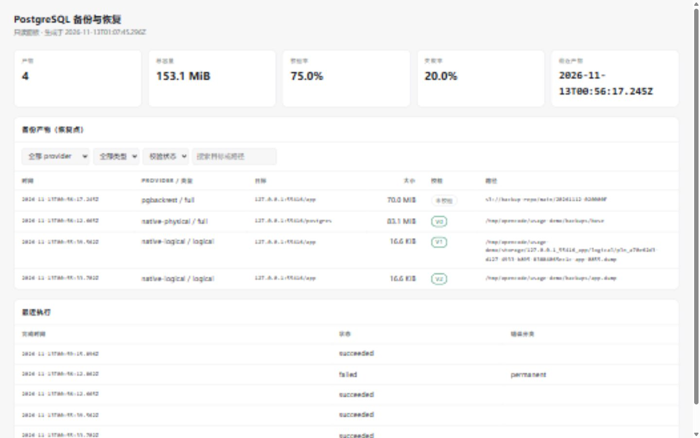

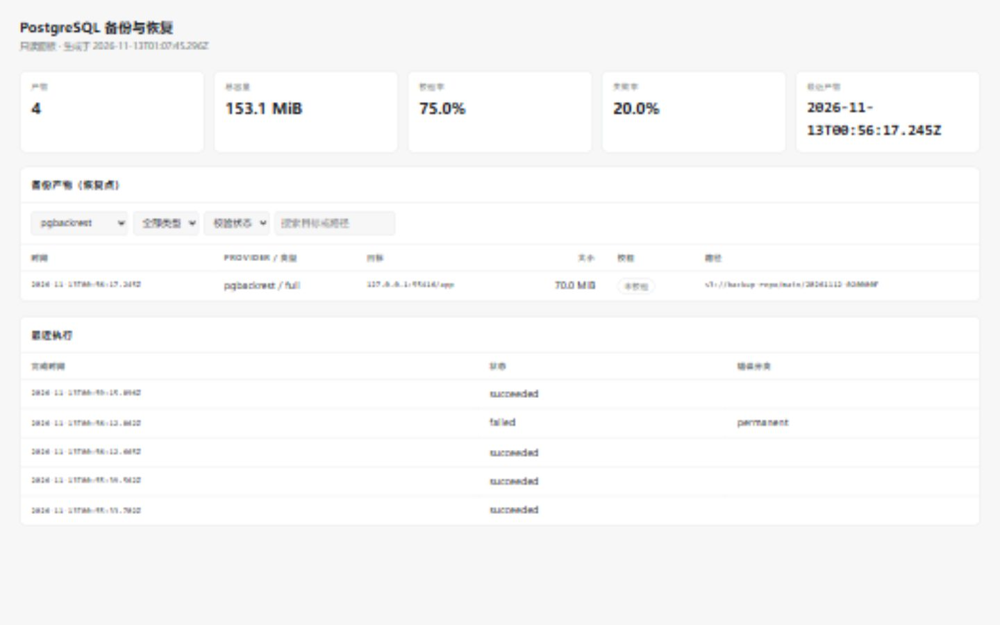

上面两张图来自同一控制库：第一张是默认视图（4 个产物、153.1 MiB、校验率 75%、失败率 20%，最近执行里有一条 `failed` / `permanent`），第二张把 provider 过滤为 `pgbackrest` 后产物只剩一行，而「最近执行」仍是全量。过滤器是纯前端 `data-*` 过滤，不重新查库；刷新页面才重新渲染。

口径：`校验率 = 有 verifiedLevel 的行 / 总行数`，`失败率 = failed attempt / 总 attempt`，`最近产物 = max(createdAt)`；「最近执行」固定取 20 条。`--since` 只过滤传入的产物与执行记录，缺省为全历史。

### 4.11 远端执行：--transport ssh|kubectl

`--transport` 只对 11 条目标类命令生效：`inspect`、`providers`、`backup`、`restore`、`pitr`、`pgbackrest-backup|restore|expire`、`walg-backup|restore|prune`。给其他命令（如 `catalog`、`dashboard`）传 `--transport` 会以用法错误退出 `2`。`exec` 例外，使用自己的 `--host` / `--pod`，且缺省就是 `ssh`。

```sh
bkagent backup --transport ssh --ssh-host dba@db1 --known-hosts /etc/backup-agent/known_hosts \
  --dsn 'postgres://backup@127.0.0.1:5432/app' --database app --out /var/backups/app.dump
bkagent exec --transport ssh --host dba@db1 --known-hosts /etc/backup-agent/known_hosts -- pgbackrest info
bkagent exec --transport kubectl --pod pg-0 --namespace prod -- psql --version
```

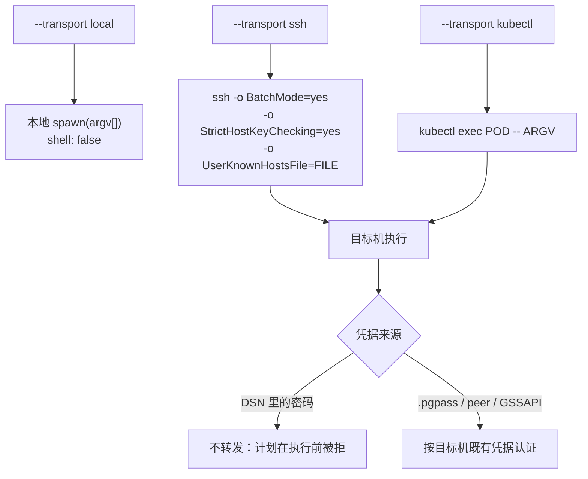

关键约束：

- SSH 强制 `BatchMode=yes` 与 `StrictHostKeyChecking=yes`，`--known-hosts` 必填；不接受「首次连接自动信任」。
- 远端计划**不转发子进程环境变量**：带 env 的远端计划在执行前被拒绝，带 Storage sink 的远端计划同样被拒。凭据必须预先放在目标机（`.pgpass` / peer / GSSAPI），DSN 中的密码不会转发。
- 远端产物记录为 `<transport>:<path>`（例如 `ssh:dba@db1:/var/backups/x.dump`），表示字节在目标机上、控制面读不到，因此 `verify --input` 不能直接吃这个路径。
- `--principal` 只被 `backup` / `restore` / `pitr` / `pgbackrest-*` / `walg-*` / `retain` / `asset-set` 接受；`--credentials <registry.json>` 只被 `backup` / `restore` 接受，DSN 从注册表条目的 `dsnEnv` 指向的环境变量读出。`inspect` 与 `verify` 不参与 principal 解析。

### 4.12 dsh 插件与 MCP

```sh
pnpm build:cli
bash scripts/install-dsh.sh          # 安装 preset 与技能到 dsh
node packages/dsh-plugin/mcp.js      # 或 bin：bkagent-mcp
```

工具定义集中在 `packages/dsh-plugin/tools.js`，同一份注册表同时派生 dsh 工具与 MCP server：

| 工具 | 对应命令 | 破坏性 |
|---|---|---|
| `pg_inspect` | `inspect --format json` | 否 |
| `pg_backup` | `backup` | 否 |
| `pg_restore` | `restore --yes …` | 是（需审批接缝） |
| `pg_verify` | `verify` | 否 |
| `pg_pitr` | `pitr --yes …` | 是（需审批接缝） |
| `pg_catalog` / `pg_report` | `catalog` / `report` | 否 |
| `kb_search` | 知识库 `ask --json` | 否 |

- dsh 侧走 `approval.request()`：`exec.agent` 缺失或审批服务不可用即失败关闭，仅 `allowed-once` 放行。
- MCP 侧没有审批通道，因此 `pg_restore` / `pg_pitr` 直接返回 `isError` 并提示需要 dsh 审批接缝——**MCP 下无法执行恢复**。
- provider 类命令（`pgbackrest-*`、`walg-*`、`retain`、`storage-*`、`asset-*`）未暴露为工具，只能经 CLI 或 `bash` 调用。

## 5. 权限与审批

破坏性计划只可能来自 6 条命令：`restore`、`pitr`、`pgbackrest-restore`、`pgbackrest-expire`、`walg-restore`、`walg-prune`。它们在「建计划后」与「执行前」各做一次授权判定；第二次判定与取得租约在同一事务内完成，若此时资产环境或审批已变化，运行以 `failed` 结束并退出 `1`——这与门禁直接拒绝的 `2` / `4` 是两条不同路径。

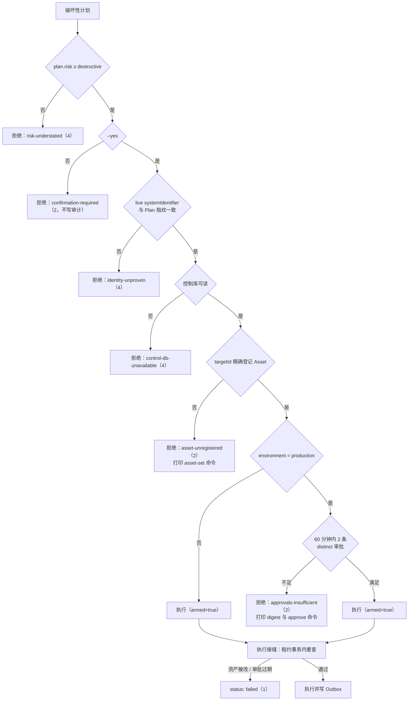

审批的语义细节：

- 审批绑定 `targetId` + Plan 的 `configDigest`，任何重新规划（配置漂移重基）都会产生新 digest，旧审批失效。
- 审批有效期 60 分钟（`approvals --ttl-minutes` 可查不同窗口），按 `approverOs` 去重，取每人的最新决定。
- 请求者自身被排除：执行者的 OS 主体与其标签的审批不计入 `distinct`，因此「自己批自己」无效。
- 同一 OS 用户提交多条不同标签的审批只算 1 条，见 §4.6 的 `distinct: 1` 示例。

资产降级走同一套门禁：生产 → 其他环境、撤销 `--protected`、降低 `criticality` 都算削弱保护，需要 `--yes` 加两条绑定「资产变更 digest」的审批（digest 由拒绝信息打印）。注册新资产不设门槛。

`asset-set --protected` 的 target 在 `retain --apply` 中整目标豁免，apply 直接拒绝（`asset-protected`），这个判定先于 digest 校验。

## 6. 例行运维

推荐三个独立调度：备份、Outbox 投递、watchdog。保留与回收不进入盲跑调度——它是「dry-run 取 digest → 人工复核 → 绑定 digest apply」的两阶段流程。

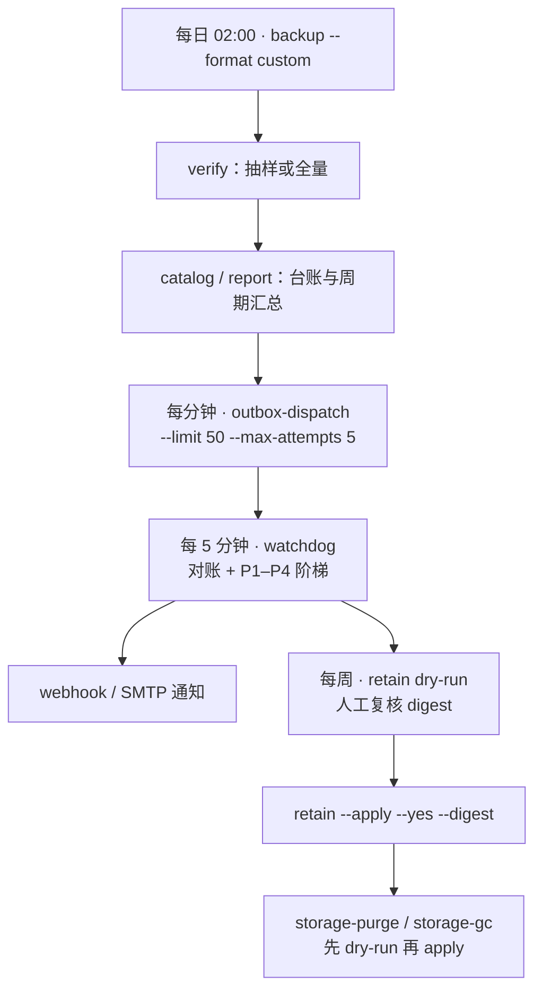

`deploy/cron.example` 与 `deploy/systemd/` 提供可直接安装的模板：

```sh
# /etc/cron.d/backup-agent（cron.d 语法，第三列是用户）
0    2  *   *   *    postgres  set -a; . "$BKAGENT_ENV"; set +a; /usr/local/bin/bkagent backup --dsn "$BKAGENT_DSN" --database "$BKAGENT_DATABASE" --out "$BKAGENT_OUTPUT" --format custom --db "$BKAGENT_CONTROL_DB" >> /var/log/bkagent-backup.log 2>&1
*    *   *   *   *    postgres  set -a; . "$BKAGENT_ENV"; set +a; /usr/local/bin/bkagent outbox-dispatch --db "$BKAGENT_CONTROL_DB" --limit 50 --max-attempts 5 >> /var/log/bkagent-outbox.log 2>&1
*/5  *   *   *   *    postgres  set -a; . "$BKAGENT_ENV"; set +a; /usr/local/bin/bkagent watchdog --db "$BKAGENT_CONTROL_DB" >> /var/log/bkagent-watchdog.log 2>&1
```

```ini
# /etc/systemd/system/backup-agent-backup.service
[Service]
Type=oneshot
User=postgres
EnvironmentFile=/etc/backup-agent/backup.env
ExecStart=/usr/local/bin/bkagent backup --dsn ${BKAGENT_DSN} --database ${BKAGENT_DATABASE} --out ${BKAGENT_OUTPUT} --format custom --db ${BKAGENT_CONTROL_DB}
```

部署要点：

- 凭据与 webhook URL 放 `/etc/backup-agent/backup.env`（`0600`，`postgres` 可读），不要写进 crontab 与 systemd unit。
- `bkagent` 需在 `PATH` 上：`install -m 0755 dist/bkagent.mjs /usr/local/bin/bkagent`；单文件安装时迁移目录必须与 bundle 同级，或用 `BKAGENT_MIGRATIONS` 指定。
- 备份与控制库应同机同卷，避免「备份成功但台账丢失」；`watchdog` 的 `stalled` 标记依赖控制库连续可写。
- 通知通道二选一：配置了 SMTP（`BKAGENT_SMTP_HOST` 必须同时有 `FROM` 与 `TO`）就优先 SMTP，否则用 `BKAGENT_WEBHOOK_URL`；两者都没有时 `watchdog` 静默（告警只留在 `alerts` 输出里），通知类 Outbox 事件不会送达，审计类 topic 仍会派发。

## 7. 故障排查

| 现象 | 原因 | 处置 |
|---|---|---|
| `no asset registered for target …`（退出 2） | `targetId` 未登记，或 `--database` 与登记的不一致 | 按提示执行 `asset-set`；`targetId` 形如 `host:port/db` |
| `requires 2 distinct approvals; have 0`（退出 2） | 生产目标缺审批 | `approve --target … --digest … --approver <id>`；第二个审批必须来自另一个 OS 用户 |
| `ignored self-approval from requester: …` | 执行者给自己审批 | 换人审批；同一 OS 用户换标签无效 |
| `retention apply refused (candidate-set-changed)`（退出 2） | 复核后候选集变化 | 重新 dry-run，用新 digest 再 apply |
| `asset-protected` | 目标被 `--protected` 豁免 | 先走降级流程解除保护，或跳过该目标 |
| `TOOL_MISSING(pgbackrest)`（`providers` 退出 1） | 工具不在 `PATH` | 安装工具或显式传 `--walg`；不要绕过能力协商 |
| `CONNECT_FAILED … Connection refused`（退出 3） | 实例不可达 | 检查端口、`pg_hba.conf`、监听地址 |
| `Unknown option '--bogus'`（退出 4） | 参数拼写错误 | 修正；注意实现里参数解析错误落到 4，不是 2 |
| `invalid --since "abc"`（退出 4） | 时间窗格式非法 | 用 ISO 时间或 `7d` 这类 `Nd` 形式；不支持 `24h` |
| `--transport ssh requires --ssh-host`（退出 2） | 给 `exec` 之外的命令用了 `exec` 的参数名 | 目标类命令用 `--ssh-host`，`exec` 用 `--host` |
| `--transport` 在 `catalog` / `dashboard` 上被拒（退出 2） | 该命令不支持远端执行 | 只读命令在控制面执行 |
| 远端计划被拒：不转发环境变量 | 计划带 env 或 Storage sink | 在目标机准备 `.pgpass` / peer / GSSAPI；不要在远端计划里配置 storage |
| `verify` 通过但目录行还是 V1 | `--input` 路径与目录行 `resolve()` 后不完全相同，或未入册 | 用目录里的原路径，或先 `artifact-add` |
| `no such table: …` / 迁移缺失 | 单文件安装找不到迁移目录 | `BKAGENT_MIGRATIONS` 指向 `dist/migrations` |
| `pg_verifybackup` 找不到 | 未在 `PATH`（Debian/Ubuntu 在 `/usr/lib/postgresql/<ver>/bin`） | 加入 `PATH`，或改用 `--format tar` 并接受 V0 缺失 |
| `storage-purge --format text` 无效果 | 该参数被接受但不读取 | 输出恒为 JSON，用 `jq` 处理 |

排查顺序建议：`inspect`（实例是否可达、版本是否在矩阵内）→ `providers`（链路工具是否就绪）→ `trace --plan`（计划到底执行了什么）→ `catalog`（台账是否记录）→ `watchdog`（是否已进入告警阶梯）。

## 8. 附录

### 附录 A：命令速查

「门禁」列：`—` 无额外要求；`yes` 需 `--yes`；`2×` 生产目标需双人复核。

| 命令 | 必需参数 | 关键可选参数（缺省） | 门禁 |
|---|---|---|---|
| `inspect` | `--dsn` 或 `BKAGENT_DSN` | `--format json\|text`（json） | — |
| `providers` | 无 | `--dsn`、`--format`（json） | — |
| `exec` | `-- <argv…>`；ssh 另需 `--host --known-hosts`；kubectl 另需 `--pod` | `--transport`（ssh）、`--port`、`--identity`、`--namespace`、`--container`、`--context`、`--kubeconfig`、`--timeout-ms` | — |
| `backup` | `--out` + DSN | `--mode logical\|physical`、`--format`、`--database`、`--jobs`（仅 directory）、`--compress`、`--table`、`--schema`、`--wal-method`、`--checkpoint`、`--max-rate`、`--parse-wal`（false）、`--label`、`--storage-kind`、`--storage-root`、`--remove-local`、`--state-dir`、`--resume`、`--principal`、`--credentials` | — |
| `restore` | `--input` + DSN | `--database`、`--format`（按输入推断）、`--create-database`、`--clean`、`--if-exists`、`--no-owner`、`--jobs`（仅 directory）、`--state-dir`、`--resume`、`--principal`、`--credentials` | yes、2× |
| `verify` | `--dsn` + `--input` | `--database`、`--format`、`--jobs`、`--no-owner`、`--keep-scratch` | — |
| `pitr` | `--data-dir --port --log --restore-command` + 目标四选一 | `--target-time\|lsn\|name\|xid`（恰好一个）、`--action promote\|pause\|shutdown`、`--verify-sql`、`--state-dir`、`--resume` | yes、2× |
| `pgbackrest-backup` | `--config --stanza` | `--repo`、`--type full\|diff\|incr`、`--ensure-stanza`、`--state-dir`、`--resume` | — |
| `pgbackrest-restore` | `--config --stanza --data-dir` | `--repo`、`--target-type`、`--target`、`--delta`、`--start-port`、`--log`、`--action`、`--state-dir`、`--resume` | yes、2× |
| `pgbackrest-expire` | `--config --stanza` | `--repo` | yes、2× |
| `walg-backup` | `--data-dir` | `--walg`、`--state-dir`、`--resume` | — |
| `walg-restore` | `--data-dir` | `--backup`（LATEST）、`--start-port`、`--log`、`--walg`、`--state-dir`、`--resume` | yes、2× |
| `walg-prune` | `--retain-full N` | `--walg` | yes、2× |
| `artifact-add` | `--target --provider --kind --path` | `--parent`、`--plan`、`--size`、`--verified-level` + `--checksum`、`--protected` | — |
| `artifact-upload` | `--id --storage-kind` | `--storage-root`、`--remove-local` | — |
| `catalog` | 无 | `--target`、`--provider`、`--since`（3650d）、`--limit`、`--history`、`--format` | — |
| `retain` | `--daily --weekly --monthly` | `--target`、`--apply`、`--digest`、`--principal` | apply 时 yes/2× |
| `storage-purge` | 无（`BKAGENT_STORAGE_ROOT`） | `--storage-kind`（fs）、`--grace-days`（7）、`--target`、`--apply`、`--digest` | apply 时 yes |
| `storage-gc` | 无 | `--storage-kind`（fs）、`--grace-days`（7）、`--apply`、`--digest` | apply 时 yes |
| `report` | 无 | `--since`（7d）、`--format markdown\|json`（markdown） | — |
| `metrics` | 无 | — | — |
| `capacity` | 无 | `--threshold-gb`（100）、`--days`（90） | — |
| `watchdog` | 无 | `--threshold-gb`（100） | — |
| `outbox-dispatch` | 无 | `--limit`、`--max-attempts` | — |
| `trace` | `--ticket` 或 `--plan` | — | — |
| `notify-test` | `--url` 或 `--smtp` | `--severity P1–P4`（P4）、`--title` | — |
| `dashboard` | `--out` 或 `--serve` | `--port`（8787）、`--since`（全历史） | — |
| `asset-set` | `--target --engine --environment --owner --criticality --data-classification --rpo-minutes --rto-minutes` | `--protected`、`--maintenance-cron`、`--maintenance-tz` | 削弱保护时 yes + 2× |
| `asset-list` | 无 | `--format` | — |
| `asset-rpo` | 无 | — | — |
| `approve` | `--target --digest --approver` | `--reject`、`--reason` | — |
| `approvals` | `--target --digest` | `--ttl-minutes`（60） | — |
| `model-policy show` | `--file` | — | — |
| `model-policy check` | `--file --task --input-tokens --output-tokens` | — | — |
| `cost record` | `--task --model --input-tokens --output-tokens` | `--ticket`、`--input-per-1k`、`--output-per-1k`、`--policy` | — |
| `cost report` | 无 | `--since`（30d） | — |

所有需要控制库的命令都接受 `--db <path>`。`--format` 对 `storage-purge` / `storage-gc` / `artifact-upload` 被接受但不读取，输出恒为 JSON。

### 附录 B：环境变量

| 变量 | 作用 |
|---|---|
| `BKAGENT_DSN` | 缺省 DSN（省略 `--dsn` 时使用） |
| `BKAGENT_DB` | 缺省控制库路径（`.bkagent/control.db`） |
| `BKAGENT_MIGRATIONS` | 迁移 SQL 目录（单文件安装时必查） |
| `BKAGENT_CREDENTIALS` | principal 注册表路径（仅 `backup` / `restore`） |
| `BKAGENT_STORAGE_ROOT` | fs / nfs 存储根 |
| `BKAGENT_WEBHOOK_URL` | 失败通知 webhook |
| `BKAGENT_SMTP_HOST` / `PORT` / `FROM` / `TO` / `USER` / `PASS` | SMTP 通道；`HOST` 必须同时有 `FROM` 与 `TO`，`PORT` 缺省 25，纯文本无 STARTTLS |
| `BKAGENT_S3_ENDPOINT` / `REGION` / `BUCKET` / `ACCESS_KEY_ID` / `SECRET_ACCESS_KEY` / `SESSION_TOKEN` | S3 配置，前五项缺一即报错 |
| `BKAGENT_CLI` | dsh / MCP 调用的后端 CLI（缺省 `dist/bkagent.mjs`） |
| `BK_KNOWLEDGE_DB` | `kb_search` 知识索引路径 |

凭据只经环境变量或 principal 注册表的 `dsnEnv` 进入子进程；DSN 密码不会出现在 argv、Plan、日志或指标标签里——`trace` 输出的步骤 argv 只有 host / port / user / dbname。

### 附录 C：退出码

| 码 | 含义 | 典型场景 |
|---|---|---|
| `0` | 成功 | 计划 `succeeded`；dry-run；`providers` 全部就绪；`exec` 远端退出 0 |
| `1` | 执行失败 | 计划 `failed` / `lease-lost`；`providers` 有 provider 不可用；`verify` 比对失败；`storage-*` 部分对象失败；上传失败；执行接缝拒绝 |
| `2` | 显式用法或授权拒绝 | 缺必需参数、`--yes` / `--digest` / `--target` 缺失、digest 不匹配、资产未登记、审批不足、未知命令、`--transport` 用在不支持的命令上 |
| `3` | 连接失败 | `CONNECT_FAILED`：实例不可达、认证被拒 |
| `4` | 其余错误 | Plan 校验问题、PITR 越窗、`asset-set` 校验、身份不可证、控制库不可读、风险标签被低估、**参数解析错误（未知选项 / 缺值 / 非法 `--since` / 输入路径不存在）** |

注意 `4` 包含参数解析错误：脚本里若用 `2` 判定「用法错误」，请同时接受 `4`。

### 附录 D：已知限制

生产使用前应了解的边界，完整清单见 [status.md](status.md) 的「Design items not implemented」：

- E-08 离线验收只覆盖 inspect / backup / verify / report / dashboard，且无独立 `plan` 子命令；E-09 真实模型 E2E 只能手工跑，未接入门禁。
- PITR 只做 LSN 窗口预检；WAL 缺口枚举、跨时间线 `.history` 校验、与 retention 求交集均未实现，也没有真实集群的 PITR 集成用例。
- 校验分级：V3 业务冒烟用例集缺失；物理备份没有事后 `pg_verifybackup`；没有字节完整性复检命令，`artifact-add` 的等级是自证。
- 目录形态产物（`pg_dump -Fd`、`pg_basebackup -Fp`）不能上传 Storage；远端产物字节不回传控制面。
- `storage-gc` 不识别 provider 归属，对 provider 仓库或共享挂载运行存在误删他人对象的风险，只在自管 storage 上使用。
- pgBackRest / WAL-G 仓库内容不入 `catalog`，只能用 `exec -- pgbackrest info` 看原始 JSON 或 `artifact-add` 手工登记。
- SMTP 无 STARTTLS；MCP 无审批通道，因此 MCP 下不能执行恢复与 PITR。
